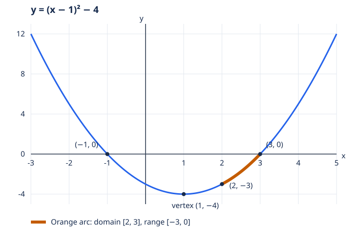

# 002 — Algebra, inequalities and functions

**Revision — 23 November 2026:** Corrected overly restrictive division rules and rational-exponent notation; added worked range arguments, a labelled function graph and authoritative references.

**Paper:** Mathematics optional, bridge chapter (supports both papers)
**Curriculum entry:** [Phase A, chapter 002](Mains-Mathematics-Curriculum.md#authoritative-chapter-index)
**Scope:** fractions, powers, factorisation, polynomials, equations, inequalities, absolute value, intervals, graphs, domains, ranges, inverse and composite functions; manipulate without losing solutions.
**Prerequisites:** school arithmetic, repaired within this chapter.

**Learning outcome.** By the end of this chapter you should be able to (a) simplify expressions with fractions, powers and factorisations without silently changing their value, (b) solve equations and inequalities while keeping track of exactly which operations are reversible, (c) find the domain and range of a function given by a formula, and (d) construct and verify the composite and inverse of a function.

---

## 1. Why this chapter exists

This chapter has no heading of its own in the official syllabus. It is a bridge: every later chapter assumes you can do this material without re-deriving it, and algebra slips can undermine otherwise sound reasoning in advanced topics. A false step in factoring or an unjustified division can turn a correct method into a wrong final answer, and in a written exam, an unjustified step also loses marks even when the final answer happens to be right.

The chapter is organised around one recurring judgement: **does this operation change the solution set?** Some operations are *reversible* (they give an equivalent statement, so nothing is gained or lost), and some are *one-directional* (they can introduce extra "solutions" that do not actually work, or silently discard real ones). Learning to tell which is which is the actual content of this chapter; the factual recipes (laws of exponents, factoring patterns) are the vocabulary you need to apply that judgement.

---

## 2. Numbers, fractions and powers

### 2.1 Fractions

A fraction a/b (with b ≠ 0) names a number, not a pair of numbers to be manipulated separately. The rules that let you combine fractions all come from one fact: a/b = c/d exactly when ad = bc (for b, d ≠ 0).

- **Common denominator:** a/b + c/d = (ad + bc)/(bd).
- **Multiplication:** (a/b)·(c/d) = (ac)/(bd).
- **Division:** (a/b) ÷ (c/d) = (a/b)·(d/c), valid only when c ≠ 0 as well as b, d ≠ 0.

**A common error.** (a + b)/a is **not** 1 + b. You can only cancel a factor that multiplies the *entire* numerator and the *entire* denominator: (a + b)/a = a/a + b/a = 1 + b/a. Cancellation across addition is a common fraction error; whenever you are tempted to "cancel," rewrite the fraction as a sum or product first and check what is actually being divided.

### 2.2 Powers and exponents

For a real number a ≠ 0 and integers m, n:

| Rule | Statement |
|---|---|
| Product | aᵐ·aⁿ = aᵐ⁺ⁿ |
| Power of a power | (aᵐ)ⁿ = aᵐⁿ |
| Negative exponent | a⁻ⁿ = 1/aⁿ |
| Zero exponent | a⁰ = 1 |
| Power of a product | (ab)ⁿ = aⁿbⁿ |

Fractional exponents extend this to roots: a^(1/n) means "the real number whose nth power is a." For this to be a single, well-defined real number:

- If n is **odd**, a^(1/n) exists and is unique for every real a (e.g. (−8)^(1/3) = −2).
- If n is **even**, a^(1/n) exists as a real number only for a ≥ 0, and by convention it denotes the *non-negative* root (e.g. 4^(1/2) = 2, not −2, even though (−2)² = 4 too).

For integers p and q with q > 0 and p/q in lowest terms, write **a^(p/q) = (a^(1/q))^p**, subject to the root restrictions above; also exclude a = 0 when p < 0. Parentheses matter: a^(p/q) is an exponent, whereas aᵖ/ᵠ can be misread as a power divided by q.

**Caution with negative bases.** (a^m)^(1/n) and a^(m/n) can disagree when a < 0 and the fraction m/n is not already in lowest terms with odd denominator, because simplifying the exponent first can silently assume a root that does not exist as a real number, or pick the wrong sign. For example, ((−8)²)^(1/6) = 64^(1/6) = 2, but you cannot shortcut this as (−8)^(2/6) = (−8)^(1/3) = −2 — the two do not match. When a base might be negative, evaluate an explicitly nested power/root expression in the order written. For a single rational exponent, first use the reduced fraction to determine its real domain; do not assume the power-of-a-power law remains valid when fractional exponents enter.

**Worked example.** Simplify (x⁻²y³)² / (x y⁻¹)³ for x, y ≠ 0.

Numerator: (x⁻²y³)² = x⁻⁴y⁶. Denominator: (xy⁻¹)³ = x³y⁻³. So the expression is x⁻⁴y⁶ / (x³y⁻³) = x⁻⁴⁻³ y⁶⁻⁽⁻³⁾ = x⁻⁷y⁹ = y⁹/x⁷.

---

## 3. Factorisation and polynomials

A **polynomial** in x is an expression a_nxⁿ + a_{n−1}x^{n−1} + … + a_1x + a_0, where the aᵢ are constants (here, real or complex numbers) and n is a non-negative integer. If a_n ≠ 0, n is the **degree** of the polynomial.

### 3.1 Factor and remainder theorems

**Remainder theorem.** If a polynomial p(x) is divided by (x − c), the remainder is p(c).

**Factor theorem.** (x − c) is a factor of p(x) if and only if p(c) = 0.

These two are really one idea: dividing p(x) by (x − c) always gives p(x) = (x − c)q(x) + r for some constant remainder r (this is why the remainder is a constant — dividing by a degree-1 polynomial leaves a remainder of degree less than 1, i.e. degree 0). Substituting x = c gives p(c) = r, which is the remainder theorem; and r = 0 exactly when (x − c) divides p(x) exactly, which is the factor theorem.

**Consequence used constantly later:** a nonzero polynomial of degree n has **at most n roots** (counted without multiplicity, it has at most n distinct roots; counted with multiplicity, exactly n roots over ℂ, by the fundamental theorem of algebra, which is not proved here). This is why, for instance, two polynomials of degree ≤ n that agree at more than n points must be identical — a fact you will use when comparing coefficients in later chapters.

### 3.2 Standard factoring patterns

| Pattern | Identity |
|---|---|
| Common factor | ab + ac = a(b + c) |
| Difference of squares | a² − b² = (a − b)(a + b) |
| Perfect square | a² ± 2ab + b² = (a ± b)² |
| Sum of cubes | a³ + b³ = (a + b)(a² − ab + b²) |
| Difference of cubes | a³ − b³ = (a − b)(a² + ab + b²) |
| Quadratic trinomial | x² + (p+q)x + pq = (x + p)(x + q) |

**Worked example.** Factor p(x) = x³ − 2x² − 5x + 6.

Try small integer candidates using the factor theorem: p(1) = 1 − 2 − 5 + 6 = 0. So (x − 1) is a factor. To find the quotient without assuming long division, match coefficients: write p(x) = (x − 1)(x² + Ax + B). Expanding gives x³ + (A − 1)x² + (B − A)x − B. Thus A − 1 = −2 gives A = −1, and −B = 6 gives B = −6; the x coefficient is then B − A = −5, as required. Hence p(x) = (x − 1)(x² − x − 6) = (x − 1)(x − 3)(x + 2). The roots are 1, 3, −2, which checks against the degree-3 bound above (at most 3 roots, and we found exactly 3 distinct ones).

---

## 4. Solving equations without losing or gaining solutions

This section is the core judgement skill of the chapter. Call an operation on an equation **reversible** if performing it and then undoing it recovers exactly the original solution set. Addition/subtraction of the same quantity to both sides, and multiplication/division of both sides by a *known nonzero constant*, are always reversible. Three common operations are **not** automatically reversible, and each has a standard repair.

### 4.1 Squaring both sides can introduce extraneous roots

If a = b then a² = b², but the converse fails: a² = b² only tells you a = b **or** a = −b. Squaring can therefore manufacture a solution that does not satisfy the original equation.

**Worked example.** Solve √(x + 2) = x.

Squaring: x + 2 = x², i.e. x² − x − 2 = 0, which factors as (x − 2)(x + 1) = 0, giving x = 2 or x = −1.

**Check each candidate in the original equation**, not the squared one: for x = 2, √4 = 2 ✓. For x = −1, √1 = 1, but x = −1, so 1 ≠ −1 ✗. The squaring step introduced x = −1 as an artifact (it satisfies x + 2 = x² but not the original equation, because the original equation also requires x ≥ 0 — a square root is never negative). The repair is always the same: **squaring is only safe when you then verify every candidate against the original, unsquared equation.**

### 4.2 Dividing by an expression that could be zero loses roots

Dividing both sides by a quantity that might equal zero is not reversible, because division by zero is undefined, and "dividing it away" silently discards the case where that quantity *is* zero — which may itself be a valid solution.

**Worked example.** Solve x² = 3x.

A common wrong move: divide both sides by x to get x = 3, missing a solution. The correct method: bring everything to one side and factor, which never requires excluding a case. x² − 3x = 0 ⟹ x(x − 3) = 0 ⟹ x = 0 or x = 3. The division approach loses x = 0 precisely because it divides by x without first asking whether x could be 0.

**General rule:** divide only after establishing that the divisor is nonzero on the case being considered ([OpenStax, equality properties][os-equality]). An expression may contain the unknown and still be known nonzero. If it could be zero, separate that case first. In x² = 3x, the case x = 0 works; in the case x ≠ 0, division by x is valid and gives x = 3. Factoring is often the simplest way to keep both cases visible, since ab = 0 exactly when a = 0 or b = 0.

### 4.3 Cross-multiplying requires excluding where a denominator is zero

A/B = C/D is equivalent to AD = BC **only when B ≠ 0 and D ≠ 0**. Cross-multiplying is reversible provided you track the excluded values and confirm the final solutions avoid them (if a found "solution" happens to be an excluded value, it must be discarded — it was never in the domain of the original equation).

**Worked example.** Solve (x + 1)/(x − 2) = 3/(x − 2).

Cross-multiplying: (x + 1)(x − 2) = 3(x − 2). But here both sides share the same denominator, so it is simpler and safer to note the equation is only defined for x ≠ 2, then subtract: (x + 1)/(x − 2) − 3/(x − 2) = 0 ⟹ (x − 2)/(x − 2) = 0, which has **no solution**, since (x − 2)/(x − 2) = 1 for every x ≠ 2 (it is never 0). Cross-multiplying carelessly here would give x + 1 = 3, i.e. x = 2 — exactly the excluded value, and therefore not a valid solution at all. This example shows why checking the domain is not a formality: it can eliminate the only candidate an algebraic shortcut produces.

---

## 5. Inequalities

The order relation < on ℝ satisfies:

- **Trichotomy:** for any real a, b, exactly one of a < b, a = b, a > b holds.
- **Adding/subtracting** the same quantity to both sides preserves the direction: a < b ⟹ a + c < b + c for any real c.
- **Multiplying by a positive number** preserves the direction: a < b and c > 0 ⟹ ac < bc.
- **Multiplying by a negative number reverses the direction:** a < b and c < 0 ⟹ ac > bc.

That last rule is the one most often forgotten, and it is the reason you cannot multiply an inequality by an expression of unknown sign.

### 5.1 Polynomial inequalities by sign chart

To solve p(x) > 0 (or <, ≥, ≤) for a polynomial p:

1. Factor p(x) completely and find its real roots; these are the **critical points**.
2. The roots divide the real line into intervals. On each interval, p(x) cannot change sign without crossing zero (because a polynomial is continuous and its only zeros are the roots you found), so p has a constant sign on each open interval between consecutive critical points.
3. Test one point in each interval, record the sign, and read off the intervals that satisfy the inequality.

**Worked example.** Solve x² − x − 6 > 0.

Factor: (x − 3)(x + 2) > 0. Critical points: x = −2, 3. Test intervals:

| Interval | Test point | (x − 3) | (x + 2) | Product |
|---|---|---|---|---|
| x < −2 | x = −3 | − | − | + |
| −2 < x < 3 | x = 0 | − | + | − |
| x > 3 | x = 4 | + | + | + |

So the solution is x < −2 or x > 3, i.e. (−∞, −2) ∪ (3, ∞). The inequality is strict, so the endpoints −2 and 3 are excluded (there p(x) = 0, not > 0).

### 5.2 Rational inequalities

**Do not cross-multiply a rational inequality by an expression of unknown sign.** If its sign is established on a particular interval, multiplication is valid there, preserving the inequality for a positive factor and reversing it for a negative one. A convenient general method is to move everything to one side, combine into a single fraction, and run a sign chart that includes the zeros of **both** the numerator and the denominator (the denominator's zeros are excluded from the solution — open circles — because the expression is undefined there).

**Worked example.** Solve (x − 1)/(x + 2) ≥ 0.

Already one fraction, already compared to 0. Critical points: x = 1 (numerator zero) and x = −2 (denominator zero, excluded).

| Interval | Test point | (x − 1) | (x + 2) | Quotient |
|---|---|---|---|---|
| x < −2 | x = −3 | − | − | + |
| −2 < x < 1 | x = 0 | − | + | − |
| x > 1 | x = 2 | + | + | + |

The solution is x < −2 or x ≥ 1, i.e. (−∞, −2) ∪ [1, ∞). Note x = 1 **is** included (the inequality is ≥ 0 and the quotient equals 0 there, which is allowed), while x = −2 is **never** included, because the expression is undefined there regardless of what the inequality symbol is.

---

## 6. Absolute value and intervals

### 6.1 Absolute value

|x| is the distance of x from 0 on the real line, defined piecewise:

|x| = x if x ≥ 0, and |x| = −x if x < 0.

Two properties you will reuse throughout the course:

- **Multiplicativity:** |ab| = |a|·|b|.
- **Triangle inequality:** |a + b| ≤ |a| + |b|, with equality exactly when a and b have the same sign (or one is zero). This inequality reappears constantly in the analysis chapters (014–019), where it is the standard tool for bounding a sum of two quantities by the sum of their individual bounds.

### 6.2 Solving equations and inequalities with absolute value

To solve |E| = k for an expression E and constant k:

- If k < 0: **no solution** (a distance cannot be negative).
- If k = 0: solve E = 0.
- If k > 0: solve E = k **or** E = −k (two separate cases — do not drop either).

To solve |E| < k (k > 0): this means E is within k of 0, i.e. **−k < E < k**, a single two-sided inequality.

To solve |E| > k (k > 0): this means E is further than k from 0, i.e. **E < −k or E > k** — a union of two separate rays, not a single interval. This is the case most often mishandled: students sometimes write it as a single compound inequality, which is wrong, because the solution set is genuinely disconnected.

**Worked example.** Solve |2x − 3| ≤ 5.

This means −5 ≤ 2x − 3 ≤ 5. Add 3 throughout: −2 ≤ 2x ≤ 8. Divide by 2 (positive, so the direction is preserved): −1 ≤ x ≤ 4. Solution: [−1, 4].

**Worked example.** Solve |x − 1| > 3.

This means x − 1 < −3 or x − 1 > 3, i.e. x < −2 or x > 4. Solution: (−∞, −2) ∪ (4, ∞) — two separate rays, as the case analysis above predicts.

### 6.3 Interval notation

| Notation | Meaning | Endpoints included? |
|---|---|---|
| (a, b) | a < x < b | neither |
| [a, b] | a ≤ x ≤ b | both |
| [a, b) | a ≤ x < b | a only |
| (a, b] | a < x ≤ b | b only |
| (a, ∞) | x > a | none (unbounded) |
| (−∞, b] | x ≤ b | b (unbounded below) |

A square bracket means the endpoint is attained and included; a round bracket (or ∞/−∞, which are never attained) means it is excluded.

---

## 7. Functions: domain, range, graphs

A **function** f from a set A (the domain) to a set B (the codomain) assigns to every element of A **exactly one** element of B. Two things can go wrong with a proposed rule and either one disqualifies it as a function on the stated domain: it can fail to produce an output for some input (undefined), or it can produce more than one output for some input. (A fully formal definition of a function as a set of ordered pairs comes in chapter 005; the working description above is enough for this chapter's purposes.)

### 7.1 Domain

When a function is given only by a formula, its **implied domain** is the largest subset of ℝ on which the formula produces a single well-defined real number. The usual restrictions:

- A denominator cannot be zero.
- An even root (square root, fourth root, …) cannot have a negative argument.
- (Later, once logarithms are introduced in chapter 003: the argument of a logarithm must be positive.)

When a formula combines several such restrictions, the domain is the **intersection** of the individual restrictions — every condition must hold simultaneously.

**Worked example.** Find the domain of f(x) = √(x − 1) / [(x − 3)(x + 2)].

Two restrictions apply simultaneously:

1. The square root needs x − 1 ≥ 0, i.e. x ≥ 1.
2. The denominator needs (x − 3)(x + 2) ≠ 0, i.e. x ≠ 3 and x ≠ −2.

Intersecting: x ≥ 1, excluding x = 3 (note x = −2 is already excluded by x ≥ 1, so it adds nothing new here). Domain: [1, 3) ∪ (3, ∞).

### 7.2 Range: prove both the restriction and attainability

The **range** is the set of outputs actually attained. To find it, ask which y allow f(x) = y for at least one x **in the stated domain** ([OpenStax, domain and range][os-range]). Showing that outputs cannot go below a bound is only half the work: show that every claimed output can occur.

**Worked example 1 — a quadratic.** Let f(x) = x² − 2x − 3, with domain ℝ. Complete the square:

**f(x) = (x − 1)² − 4.**

Since a square is nonnegative, f(x) ≥ −4, with equality at x = 1. Conversely, for any y ≥ −4, the choice x = 1 + √(y + 4) is real and satisfies f(x) = y. Therefore the range is **[−4, ∞)**.

Now restrict the same formula to **2 ≤ x ≤ 3**. Then 1 ≤ x − 1 ≤ 2, so 1 ≤ (x − 1)² ≤ 4 and −3 ≤ f(x) ≤ 0. Every y in [−3, 0] is attained by x = 1 + √(y + 4), which lies in [2, 3]. The restricted range is **[−3, 0]**. A formula alone does not determine the range without its domain.

**Worked example 2 — a rational function.** Let g(x) = (2x + 1)/(x − 3), x ≠ 3. Solve y = g(x):

y(x − 3) = 2x + 1 ⇒ x(y − 2) = 3y + 1.

If y = 2, the original equation would require 2x − 6 = 2x + 1, which is impossible. If y ≠ 2, x = (3y + 1)/(y − 2) exists. This x can never equal 3, because that would imply 3y + 1 = 3y − 6. Thus every y other than 2 is attained by an allowed input, and the range is **(−∞, 2) ∪ (2, ∞)**. This also supplies the range needed to construct the inverse in Section 8.3.

### 7.3 Graphs: read inputs horizontally and outputs vertically

A graph consists of points **(x, f(x))**: move to the input on the horizontal axis, then to its output on the vertical axis. The graph below is drawn from the quadratic in Example 1. The orange portion uses only the restricted domain [2, 3].

*Original graph generated from the stated formula; the visible plotting window is finite, but the full parabola continues upward on both sides.*

| Input x | −1 | 0 | 1 | 2 | 3 |
|---|---:|---:|---:|---:|---:|
| Output f(x) | 0 | −3 | −4 | −3 | 0 |

Read three features together: the **vertex** (turning point) is (1, −4), the x-intercepts (where y = 0) are −1 and 3, and the y-intercept (where x = 0) is −3. The lowest point is included, explaining the square bracket in [−4, ∞). Restricting the inputs to [2, 3] keeps only the orange arc; its outputs run from −3 to 0.

A function is **strictly increasing** on an interval when x₁ < x₂ implies f(x₁) < f(x₂), and **strictly decreasing** when it implies f(x₁) > f(x₂). Here the curve decreases up to x = 1 and increases thereafter. You can justify this without calculus: for inputs on the same side of 1, compare their nonnegative distances from 1 and square those distances. Chapter 017 later develops derivative tests for more complicated functions.

The **vertical-line test** asks whether a proposed graph gives more than one output for a single input. Any vertical line meeting it twice disqualifies it as the graph of a function y = f(x). The **horizontal-line test**, used below, asks a different question: whether distinct inputs can give the same output. Our parabola passes the first test but fails the second on ℝ, since f(0) = f(2) = −3.

---

## 8. Inverse and composite functions

The domain/range and inverse distinctions below can also be checked in [OpenStax, inverse functions][os-inverse].

### 8.1 Composition

Given f and g, the **composite** (f ∘ g)(x) = f(g(x)) means: first apply g, then apply f to the result. **Order matters** — f ∘ g and g ∘ f are generally different functions, and the domain of f ∘ g is restricted by *both* functions: x must be in the domain of g, and g(x) must then be in the domain of f.

**Worked example.** Let f(x) = x², g(x) = x + 1. Then (f ∘ g)(x) = f(x + 1) = (x + 1)², while (g ∘ f)(x) = g(x²) = x² + 1. These are different: at x = 1, (f ∘ g)(1) = 4 but (g ∘ f)(1) = 2.

### 8.2 Injectivity and invertibility

A function f is **injective** (one-to-one) if distinct inputs always give distinct outputs: f(a) = f(b) implies a = b. Graphically, this is the horizontal line test — no horizontal line crosses the graph more than once.

A function has an **inverse function** f⁻¹, defined on the range of f, satisfying f⁻¹(f(x)) = x for all x in the domain of f and f(f⁻¹(y)) = y for all y in the range of f, exactly when f is injective on its domain. (Full treatment of injective/surjective as formal properties of maps is in chapter 005; the working idea here is enough to construct inverses by hand.)

If f is **not** injective on its natural domain, it can sometimes be made invertible by **restricting the domain** to a piece on which it is injective. This is not a technicality you can skip: it is exactly the device used in chapter 003 to define inverse trigonometric functions (sin is not injective on all of ℝ, so sin⁻¹ is defined only after restricting sin to [−π/2, π/2]).

**Worked example.** f(x) = x² is not injective on ℝ (f(2) = f(−2) = 4), so it has no inverse on all of ℝ. Restricted to x ≥ 0, it is injective, and its inverse there is f⁻¹(x) = √x.

### 8.3 Finding an inverse algebraically

To find f⁻¹ for an invertible f given by a formula: write y = f(x), solve for x in terms of y, then swap the names (the inverse function's input is traditionally also called x).

**Worked example.** Find the inverse of f(x) = (2x + 1)/(x − 3), x ≠ 3.

Set y = (2x + 1)/(x − 3). Multiply out: y(x − 3) = 2x + 1 ⟹ xy − 3y = 2x + 1 ⟹ x(y − 2) = 3y + 1 ⟹ x = (3y + 1)/(y − 2), provided y ≠ 2. Swapping names: f⁻¹(x) = (3x + 1)/(x − 2). You can verify f(f⁻¹(x)) = x by substitution, though the algebra is a little long; doing this check once is good practice in exactly the "track every restriction" habit this chapter is building — notice that the domain restriction on f (x ≠ 3) becomes the *range* restriction on f⁻¹, and the new restriction (y ≠ 2) on f's range becomes the domain restriction on f⁻¹.

### 8.4 The graph of an inverse

Because f⁻¹(f(x)) = x, the point (x, f(x)) on the graph of f corresponds to the point (f(x), x) on the graph of f⁻¹ — the coordinates are swapped. This means the graph of f⁻¹ is the reflection of the graph of f across the line y = x.

---

## 9. Where this leads

This chapter is deliberately not tied to one syllabus heading, so its payoff appears across several later chapters:

- **Chapter 003** restricts trigonometric functions to define their inverses — exactly the domain-restriction device from section 8.2.
- **Chapters 006 and 017** (calculus) take domains as given and ask what happens *within* them; an error in the domain here becomes an error in "where the theorem applies" later.
- **Chapters 014–019** (real analysis) use the triangle inequality from section 6.1 as a basic tool, and reuse the sign-chart habit from section 5 to bound expressions.
- A PYQ that illustrates why careful domain-reading matters is [2024 Paper I, Question 1(c)](Mains-Mathematics-PYQS/2024-Mains-Mathematics.md#paper-i), which asks you to discuss the continuity of a function defined piecewise, with one formula for x ≠ 0 and a separately specified value at x = 0. Answering it (once continuity itself is covered in chapter 016) starts with exactly the reading skill practised in section 7.1: identifying the domain and reading a piecewise definition correctly before any calculus is applied. This chapter does not attempt the continuity argument itself — only the groundwork it depends on.

---

## 10. Completion check

Before moving on, confirm you can do each of these without looking back at this chapter:

- Explain why (a + b)/a ≠ 1 + b, and state the cancellation rule that is actually valid.
- Factor a cubic with an integer root using the factor theorem, and state the degree-n root bound.
- Solve an equation that requires squaring both sides, and explain why checking the candidates against the *original* equation is not optional.
- Solve a rational inequality using a sign chart, correctly excluding the denominator's zeros.
- Solve an absolute-value inequality of the form |E| > k, and explain why its solution is a union of two rays rather than a single interval.
- Find a quadratic's range by completing the square and checking attainability; explain how restricting its domain changes its graph and range.
- Find the domain of a function combining a root and a denominator, and find the inverse of a simple rational function, explicitly tracking how domain restrictions on f become range restrictions on f⁻¹.

The next chapter (003) builds directly on this one: trigonometric identities, inverse trigonometric functions (via the domain-restriction idea from section 8.2), and complex arithmetic all assume fluent, careful algebra of the kind practised here.

## 11. Sources

- **OpenStax, Rice University.** [Precalculus 2e, §1.7 Inverse Functions][os-inverse]. Accessed 23 November 2026.

- **OpenStax, Rice University.** [Elementary Algebra 2e, §2.2 Division and Multiplication Properties of Equality][os-equality]. Accessed 23 November 2026.

- **OpenStax, Rice University.** [Precalculus 2e, §1.2 Domain and Range][os-range]. Accessed 23 November 2026.

[os-range]: https://openstax.org/books/precalculus-2e/pages/1-2-domain-and-range
[os-equality]: https://openstax.org/books/elementary-algebra-2e/pages/2-2-solve-equations-using-the-division-and-multiplication-properties-of-equality

[os-inverse]: https://openstax.org/books/precalculus-2e/pages/1-7-inverse-functions
