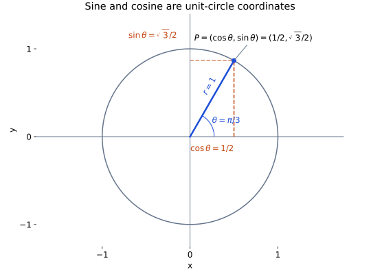

# 003 — Trigonometry and complex numbers
## Part 1 of 3 — Radians, trigonometric identities and inverse functions

**Paper:** Mathematics optional, both-paper foundation bridge.
**Learning outcome:** Derive and apply trigonometric identities while distinguishing principal values from full solution sets.

**Curriculum entry:** [Chapter 003](Mains-Mathematics-Curriculum.md#phase-a--orientation-and-selective-bridges).

**Scope:** radians, unit-circle functions, identities, equations and real inverse trigonometry.

**Prerequisites:** [002](002-algebra-inequalities-and-functions.md), especially fractions, square roots, equations, domains and inverse functions. A circle consists of points at a fixed distance from its centre; the elementary right-triangle relation is $a^2+b^2=c^2$. These geometric facts are used below.

**Navigation:** [Chapter overview](003-trigonometry-and-complex-numbers.md) · [Part 2](003-trigonometry-and-complex-numbers-part-2.md) · [Part 3](003-trigonometry-and-complex-numbers-part-3.md).

## 1. Measure an angle by the arc it turns through

Place the initial ray on the positive horizontal axis. Counterclockwise rotation is positive; clockwise rotation is negative. If a rotation sweeps out an arc of length $s$ on a circle of radius $r>0$, its radian measure is

$$
\theta=\frac{s}{r}.
$$

For a negative rotation, use a signed arc length. Similar circles scale the arc and radius by the same factor, so this ratio depends on the rotation, not the size of the circle. A full circumference is $2\pi r$, giving one full turn $2\pi$ radians, hence

$$
180^\circ=\pi\text{ radians},\qquad
\theta_{\rm rad}=\theta_{\rm deg}\frac{\pi}{180}.
$$

For example, $150^\circ=5\pi/6$, while $-3\pi/4=-135^\circ$. An arc of length $3\pi$ metres on a circle of radius 6 metres subtends $\pi/2$ radians. These definitions and conversions follow [OpenStax §5.1][angles].

Radians express a ratio of lengths, so the ratio is dimensionless; the label “rad” still identifies the kind of quantity. Unless a degree symbol is written, this course uses radians. The formula $s=r\theta$ takes $\theta$ in radians. A calculator in degree mode will not evaluate an input such as $\pi/6$ as intended.

Angles differing by $2k\pi$, where $k\in\mathbb Z$ means any integer, end on the same ray. They are **coterminal**, although they describe different amounts of rotation. Thus $-\pi/2$, $3\pi/2$ and $7\pi/2$ have the same terminal ray.

## 2. Define sine and cosine before using triangle mnemonics

On the circle of radius 1 centred at the origin, let the terminal ray meet the circle at $P=(x,y)$. Define

$$
\cos\theta=x,\qquad \sin\theta=y.
$$

This defines both functions for every real angle, including negative angles and angles greater than a full turn. The familiar right-triangle ratios follow by scaling: on a circle of radius $r$, the coordinates are $x=r\cos\theta$, $y=r\sin\theta$. In a first-quadrant right triangle, cosine is adjacent side divided by hypotenuse, and sine is opposite side divided by hypotenuse. The circle definition is the general one. See [OpenStax §5.2][circle].

*Original diagram. The displayed angle is $\pi/3$; the same coordinate definition applies in every quadrant.*

Since a point on this circle satisfies $x^2+y^2=1$,

$$
\sin^2\theta+\cos^2\theta=1.
$$

Here $\sin^2\theta$ means $(\sin\theta)^2$, not $\sin(\theta^2)$. Each coordinate lies between $-1$ and 1, so both sine and cosine have domain $\mathbb R$ and range $[-1,1]$.

The other four functions are ratios or reciprocals:

| Function | Definition | Excluded angles, $k\in\mathbb Z$ |
|---|---|---|
| $\tan\theta$ | $\sin\theta/\cos\theta$ | $\pi/2+k\pi$ |
| $\cot\theta$ | $\cos\theta/\sin\theta$ | $k\pi$ |
| $\sec\theta$ | $1/\cos\theta$ | $\pi/2+k\pi$ |
| $\csc\theta$ (also cosec) | $1/\sin\theta$ | $k\pi$ |

The exclusions follow from zero denominators, not from a calculator's behaviour. Dividing the circle identity by $\cos^2\theta$ or $\sin^2\theta$, only where nonzero, gives

$$
1+\tan^2\theta=\sec^2\theta,\qquad
1+\cot^2\theta=\csc^2\theta.
$$

### Exact values come from two triangles

An isosceles right triangle has legs 1 and 1 and hypotenuse $\sqrt2$. Its acute angles are $\pi/4$. Bisecting an equilateral triangle of side 2 gives a right triangle with hypotenuse 2, short side 1 and remaining side $\sqrt3$. Its angles are $\pi/6$ and $\pi/3$. This yields the non-axis entries in the table; the axis entries follow directly from circle coordinates.

| $\theta$ | 0 | $\pi/6$ | $\pi/4$ | $\pi/3$ | $\pi/2$ |
|---|---:|---:|---:|---:|---:|
| $\sin\theta$ | 0 | $1/2$ | $1/\sqrt2$ | $\sqrt3/2$ | 1 |
| $\cos\theta$ | 1 | $\sqrt3/2$ | $1/\sqrt2$ | $1/2$ | 0 |
| $\tan\theta$ | 0 | $1/\sqrt3$ | 1 | $\sqrt3$ | undefined |

Outside the first quadrant, use the coordinate signs. For $5\pi/6$, the terminal point is the reflection of the $\pi/6$ point across the vertical axis. Consequently

$$
\sin(5\pi/6)=1/2,\quad
\cos(5\pi/6)=-\sqrt3/2,\quad
\tan(5\pi/6)=-1/\sqrt3.
$$

The acute angle to the nearest horizontal-axis ray is the **reference angle**. It gives the magnitudes; the quadrant gives the signs.

### Symmetry, period and graph behaviour

Reflection across the horizontal axis replaces $\theta$ by $-\theta$, changing $y$ but not $x$. Thus

$$
\sin(-\theta)=-\sin\theta,\qquad
\cos(-\theta)=\cos\theta.
$$

Sine is **odd**, cosine is **even**, and tangent is odd on its domain. A function is periodic with period $T>0$ if shifting any allowed input by $T$ preserves its value and domain. Full turns give sine and cosine period $2\pi$; half-turns change both coordinate signs and preserve their ratio, so tangent has period $\pi$.

For one turn, cosine reads $1,0,-1,0,1$ and sine reads $0,1,0,-1,0$ at $0,\pi/2,\pi,3\pi/2,2\pi$. Between those angles the point moves continuously around the circle. On $[-\pi/2,\pi/2]$, the vertical coordinate increases from $-1$ to 1; on $[0,\pi]$, the horizontal coordinate decreases from 1 to $-1$. These monotone pieces will define inverses.

For $A\sin(bx+c)+d$, with $A\ne0$ and $b\ne0$, the output range is $[d-|A|,d+|A|]$, the period is $2\pi/|b|$, and rewriting $bx+c=b(x+c/b)$ identifies the horizontal shift $-c/b$. For instance, $2\sin(3x-\pi)+1$ has range $[-1,3]$, period $2\pi/3$, and shift $\pi/3$. Track input and output transformations rather than assigning the constant $c$ itself as the shift.

## 3. Derive identities from addition of rotations

An **identity** is an equality valid for every input on its stated common domain. It differs from an equation to be solved, which may hold only at particular inputs.

Rotate a pair of perpendicular unit directions through an angle $a$. The horizontal unit direction becomes $(\cos a,\sin a)$; the vertical unit direction becomes $(-\sin a,\cos a)$, since it is a further quarter-turn. A point $(x,y)$ therefore rotates to

$$
(x\cos a-y\sin a,\ x\sin a+y\cos a).
$$

This uses the elementary geometric fact that a rotation preserves lengths, perpendicularity and the addition of directed displacements. Apply it to $(x,y)=(\cos b,\sin b)$, which ends at angle $a+b$. Comparing coordinates gives

$$
\cos(a+b)=\cos a\cos b-\sin a\sin b,
$$
$$
\sin(a+b)=\sin a\cos b+\cos a\sin b.
$$

Replacing $b$ by $-b$ and using parity gives the subtraction formulas. Dividing the sine addition formula by the cosine addition formula gives

$$
\tan(a+b)=\frac{\tan a+\tan b}{1-\tan a\tan b},
$$

provided $\cos a\ne0$, $\cos b\ne0$, and $\cos(a+b)\ne0$. The sine/cosine formulas have no real exclusions; the tangent version does. These identities can be checked against [NIST DLMF §4.21][identities].

**Worked example — an angle not in the table.** Since $5\pi/12=\pi/4+\pi/6$,

$$
\sin(5\pi/12)=\frac1{\sqrt2}\frac{\sqrt3}{2}
+\frac1{\sqrt2}\frac12
=\frac{\sqrt6+\sqrt2}{4}.
$$

The answer is positive and below 1, as required for this first-quadrant angle.

### Generate the formulas you need

Putting $a=b=\theta$ gives

$$
\sin2\theta=2\sin\theta\cos\theta,
$$
$$
\cos2\theta=\cos^2\theta-\sin^2\theta
=1-2\sin^2\theta=2\cos^2\theta-1.
$$

Solving the last two forms for the squares gives the **power-reduction** formulas

$$
\sin^2\theta=\frac{1-\cos2\theta}{2},\qquad
\cos^2\theta=\frac{1+\cos2\theta}{2}.
$$

Replacing $2\theta$ by $\theta$ yields half-angle squares. Taking square roots requires a sign:

$$
\sin(\theta/2)=\pm\sqrt{\frac{1-\cos\theta}{2}}.
$$

Choose the sign from the quadrant of $\theta/2$. If $\theta=5\pi/3$, its half is $5\pi/6$, so the sine is positive; the negative root would be incorrect.

Adding or subtracting the addition formulas also yields

$$
2\sin a\cos b=\sin(a+b)+\sin(a-b),
$$
$$
2\cos a\cos b=\cos(a+b)+\cos(a-b),
$$
$$
2\sin a\sin b=\cos(a-b)-\cos(a+b).
$$

For example, $\sin3x\cos x=(\sin4x+\sin2x)/2$. Such rewrites will make products easier to integrate later. Conversely, setting $a=(u+v)/2$, $b=(u-v)/2$ in the first identity gives

$$
\sin u+\sin v=2\sin\frac{u+v}{2}\cos\frac{u-v}{2}.
$$

Deriving a formula from addition and parity reduces the number of independent facts to memorise.

### Combine two waves with the same argument

If real $A,B$ are not both zero, set $R=\sqrt{A^2+B^2}>0$ and choose $\phi$ with $\cos\phi=A/R$, $\sin\phi=B/R$. Expansion proves

$$
A\sin x+B\cos x=R\sin(x+\phi).
$$

Both equations for $\phi$ matter; tangent alone can select the wrong quadrant. For $A=B=1$, $R=\sqrt2$, $\phi=\pi/4$, so $\sin x+\cos x=\sqrt2\sin(x+\pi/4)$. Its exact range is $[-\sqrt2,\sqrt2]$, with every value attained.

## 4. Solve equations without losing angles

If $\alpha$ is one angle with a required function value, circle symmetry and repetition give

$$
\sin x=\sin\alpha
\quad\Longleftrightarrow\quad
x=\alpha+2k\pi\ \text{or}\ x=\pi-\alpha+2k\pi,
$$
$$
\cos x=\cos\alpha
\quad\Longleftrightarrow\quad x=\pm\alpha+2k\pi,
$$
$$
\tan x=\tan\alpha
\quad\Longleftrightarrow\quad x=\alpha+k\pi,
$$

where $k\in\mathbb Z$; tangent requires $\alpha$ and $x$ in its domain. Some exceptional values make the displayed families overlap, which is harmless. If an interval is specified, retain only the values inside it, respecting endpoints.

**Worked example — a double angle.** Solve $\sin2x=1/2$ on $0\le x<2\pi$. First solve for the entire argument:

$$
2x=\pi/6+2k\pi\quad\text{or}\quad2x=5\pi/6+2k\pi.
$$

Hence $x=\pi/12+k\pi$ or $x=5\pi/12+k\pi$. Filtering the requested interval gives

$$
x=\pi/12,\ 5\pi/12,\ 13\pi/12,\ 17\pi/12.
$$

Taking only $2x=\pi/6$ misses three solutions. Likewise, dividing by a function can lose solutions: $\sin x=2\sin x\cos x$ should be factored as $\sin x(1-2\cos x)=0$. Its solutions come from $\sin x=0$ **or** $\cos x=1/2$; dividing first by $\sin x$ discards the first family.

For inequalities, signs also matter. On $0\le x<2\pi$, $\sin x>1/2$ exactly for $\pi/6<x<5\pi/6$: these are the unit-circle points above height $1/2$. Equality endpoints are excluded because the inequality is strict.

## 5. An inverse function chooses one angle

Sine is not injective on $\mathbb R$, so it has no inverse function there. Restrict it to $[-\pi/2,\pi/2]$, where it is strictly increasing and covers $[-1,1]$ once. Its inverse is **arcsine**. Cosine and tangent use different restrictions, shown below; these are the usual real conventions in [OpenStax §6.3][inverse].

| Inverse | Domain | Range of principal values | Restricted original function |
|---|---|---|---|
| $\arcsin x$ | $[-1,1]$ | $[-\pi/2,\pi/2]$ | sine on that interval |
| $\arccos x$ | $[-1,1]$ | $[0,\pi]$ | cosine on that interval |
| $\arctan x$ | $\mathbb R$ | $(-\pi/2,\pi/2)$ | tangent on that interval |

On its restricted interval, tangent increases from arbitrarily negative to arbitrarily positive values. Its increase can be seen without derivatives: if $-\pi/2<a<b<\pi/2$, then

$$
\tan b-\tan a=\frac{\sin(b-a)}{\cos a\cos b}>0.
$$

Here $0<b-a<\pi$ gives positive numerator and both cosines are positive. Near either excluded endpoint the cosine tends to zero while the sine tends to $-1$ or 1, giving the unbounded ends. Formal limit language is developed in chapter 016.

The notation $\sin^{-1}x$ often means arcsine, **not** $1/\sin x$. Use $\arcsin x$ when that distinction matters. For the reciprocal inverse functions, a convention must be stated. In this chapter take $\operatorname{arccot}x=\pi/2-\arctan x\in(0,\pi)$, $\operatorname{arcsec}x=\arccos(1/x)$, and $\operatorname{arccsc}x=\arcsin(1/x)$, the last two defined for $|x|\ge1$. Other texts may choose different arccot ranges.

### Composition is sensitive to the range restriction

For $-1\le t\le1$, $\sin(\arcsin t)=t$. But $\arcsin(\sin x)=x$ only for $x\in[-\pi/2,\pi/2]$. For example,

$$
\arcsin(\sin(5\pi/6))=\arcsin(1/2)=\pi/6,
$$

not $5\pi/6$. Likewise $\arctan(\tan(3\pi/4))=-\pi/4$. The inverse returns the unique angle in its chosen range with the required value.

**Worked example — simplify a composite with its sign justified.** Let $\alpha=\arcsin t$, $-1\le t\le1$. Then $\sin\alpha=t$, and $\cos\alpha\ge0$ on the arcsine range. Therefore

$$
\cos(\arcsin t)=\sqrt{1-t^2}.
$$

For $\alpha=\arccos t$, sine is nonnegative on $[0,\pi]$, so $\sin(\arccos t)=\sqrt{1-t^2}$. For $\alpha=\arctan t$, cosine is positive, giving

$$
\cos(\arctan t)=\frac1{\sqrt{1+t^2}},\qquad
\sin(\arctan t)=\frac{t}{\sqrt{1+t^2}}.
$$

The sign of the second expression follows the sign of $t$, as it must.

An addition formula for tangent does not automatically produce a correct addition formula for principal arctangents. For example, $\arctan2+\arctan3=3\pi/4$: both terms lie in $(\pi/4,\pi/2)$, their sum lies in $(\pi/2,\pi)$, and its tangent is $(2+3)/(1-6)=-1$. Applying $\arctan$ directly to that ratio returns $-\pi/4$, requiring a correction of $\pi$. Always locate the angle before choosing a principal representative.

## Revision and next steps

Reconstruct the addition formulas and derive a double-angle or product formula from them. Explain, using domains, why tangent identities need exclusions. Revisit the double-angle equation until the general solution and interval filtering are separate steps. Explain why an inverse trigonometric value and the full solution set of a trigonometric equation answer different questions.

[Part 2](003-trigonometry-and-complex-numbers-part-2.md) develops exponentials and hyperbolic functions. Part 3 will reuse this part's rotation formulas to explain complex multiplication.

## Update watch

The mathematical definitions, identities and reasoning taught here are stable; no routine factual update is needed. Revisit only if a cited reference is corrected or the course changes its notation, domain or principal-value conventions.

## Sources

All accessed **24 November 2026**. Explanations, examples and diagram are original; these references support the definitions and identities.

- OpenStax, Rice University, *Precalculus 2e*, [§5.1 Angles][angles] and [§5.2 Unit Circle: Sine and Cosine Functions][circle].
- NIST, *Digital Library of Mathematical Functions*, [§4.21 Trigonometric Identities][identities].
- OpenStax, Rice University, *Precalculus 2e*, [§6.3 Inverse Trigonometric Functions][inverse].

[angles]: https://openstax.org/books/precalculus-2e/pages/5-1-angles
[circle]: https://openstax.org/books/precalculus-2e/pages/5-2-unit-circle-sine-and-cosine-functions
[identities]: https://dlmf.nist.gov/4.21
[inverse]: https://openstax.org/books/precalculus-2e/pages/6-3-inverse-trigonometric-functions
