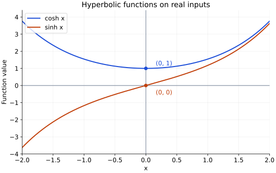

# 003 — Trigonometry and complex numbers
## Part 2 of 3 — Exponentials, logarithms and hyperbolic functions

**Paper and entry:** Mathematics optional, both-paper foundation bridge; [curriculum 003](Mains-Mathematics-Curriculum.md#phase-a--orientation-and-selective-bridges).

**Scope:** real exponentials and logarithms, equations and inequalities, and real hyperbolic functions.

**Prerequisites:** [002](002-algebra-inequalities-and-functions.md), especially powers, inverse functions and inequalities; [Part 1](003-trigonometry-and-complex-numbers-part-1.md) for comparison with circular functions. No derivatives or infinite-series methods are assumed.

**Navigation:** [Chapter overview](003-trigonometry-and-complex-numbers.md) · [Part 1](003-trigonometry-and-complex-numbers-part-1.md) · [Part 3](003-trigonometry-and-complex-numbers-part-3.md).

## 1. Extend powers without losing the base restriction

Integer powers mean repeated multiplication; negative powers mean reciprocals. For a positive base $a$, rational powers $a^{p/q}$ are defined using the unique positive $q$th root, so the familiar product law extends from integers to rationals. To define $a^x$ for an irrational real $x$, approximate $x$ by rationals and take the corresponding limiting value of $a$ raised to those rational powers.

That last sentence describes a construction, not a proof that every such approximation gives the same answer. Its justification uses completeness and limits, developed in [014](014-real-numbers-completeness-and-sequences.md) and [016](016-limits-continuity-and-compactness.md). For this operational bridge, use the resulting standard real exponential and its laws, as in [OpenStax §4.1][exp]:

$$
a^{x+y}=a^xa^y,\quad a^{-x}=1/a^x,\quad
(a^x)^y=a^{xy}\qquad(a>0;\ x,y\in\mathbb R).
$$

The positive-base restriction allows arbitrary real exponents. An expression such as $(-2)^{1/2}$ has no real value, so a negative base does not define a real exponential on all of $\mathbb R$. Complex extensions are treated in Part 3 and chapter 039.

For $a>1$, $a^x$ is strictly increasing, positive, and has range $(0,\infty)$. In particular, it never equals zero. For $0<a<1$, it is strictly decreasing with the same range: write $a^x=(1/a)^{-x}$. For $a=1$, it is the constant 1 and has no inverse on $\mathbb R$.

**Why monotonicity is plausible from the construction.** For $a>1$ and a positive rational $h$, the positive-root definition gives $a^h>1$. The extension preserves this inequality for every real $h>0$: choose a rational $q$ with $0<q<h$ to obtain $a^h\ge a^q>1$. If $y>x$, then $a^y=a^xa^{y-x}>a^x$. Full existence and continuity of the extension remain the analysis step deferred above.

The number $e\approx2.71828$ is the natural exponential base. One standard characterisation is

$$
e=\lim_{n\to\infty}\left(1+\frac1n\right)^n.
$$

Here a limit means the value approached as positive integers $n$ grow without bound. Existence of this limit is deferred to sequence theory. In calculus, this base gives $(e^x)'=e^x$; no use of that derivative is needed here. Write $\exp x=e^x$.

## 2. A logarithm returns an exponent

For $a>0$, $a\ne1$, define

$$
y=\log_a x\quad\Longleftrightarrow\quad a^y=x.
$$

The real domain is $x>0$, and the range is $\mathbb R$. Each positive input gives exactly one exponent because the exponential is strictly monotone and has range $(0,\infty)$. This is the inverse-function idea from chapter 002, now applied to powers; see [OpenStax §4.3][log].

Thus $\log_2 8=3$, $\log_2(1/8)=-3$, and $\log_a1=0$. The **natural logarithm** is $\ln x=\log_e x$. In these real sections, an unqualified logarithm in a worked calculation will be written as $\ln$ to avoid a hidden base convention.

The two inverse identities have different domains:

$$
\ln(e^t)=t\quad(t\in\mathbb R),\qquad
 e^{\ln x}=x\quad(x>0).
$$

### Derive logarithm laws from exponential laws

Let $u=\ln x$, $v=\ln y$, with $x,y>0$. Then $e^u=x$, $e^v=y$, so $xy=e^{u+v}$ and $x/y=e^{u-v}$. Applying the inverse gives

$$
\ln(xy)=\ln x+\ln y,\qquad
\ln(x/y)=\ln x-\ln y.
$$

Similarly, for real $p$ and $x>0$, $x^p=e^{p\ln x}$, so

$$
\ln(x^p)=p\ln x.
$$

The conditions matter. For $x\ne0$, $\ln(x^2)=2\ln|x|$, while $2\ln x$ is not real-defined when $x<0$. Although $(-2)(-3)=6>0$, one cannot split $\ln6$ as $\ln(-2)+\ln(-3)$ within real arithmetic. There is also no addition law $\ln(x+y)=\ln x+\ln y$: $x=y=1$ disproves it, because $\ln2\ne0$.

For a general base, put $x=a^y$ and take natural logarithms to obtain

$$
\log_a x=\frac{\ln x}{\ln a}\qquad(a>0,\ a\ne1,\ x>0).
$$

**Worked example — a logarithmic equation.** Solve

$$
\ln(x-1)+\ln(x+1)=\ln3.
$$

First impose $x-1>0$ and $x+1>0$, giving $x>1$. On that domain the left side is $\ln(x^2-1)$. Injectivity of $\ln$ gives $x^2-1=3$, hence candidates $x=\pm2$. Only $x=2$ belongs to the original domain; substitution gives $\ln1+\ln3=\ln3$. Combining logs before recording the domain could incorrectly admit $-2$.

**Worked example — an exponential equation.** Solve $e^{2x}-3e^x+2=0$. Put $t=e^x>0$. The polynomial equation is $(t-1)(t-2)=0$, so $t=1$ or 2, both allowed. Therefore $x=0$ or $x=\ln2$. The substitution must retain $t>0$; a negative polynomial root would not produce a real $x$.

### Inequalities depend on the base

Since $\ln$ is increasing, applying it to two positive quantities preserves their order. For $0<a<1$, $\log_a$ is decreasing, so it reverses order. To solve $\log_{1/2}(x-1)>2$, first require $x>1$. As $\log_{1/2}((1/2)^2)=2$, the decreasing function gives $x-1<1/4$. The result is

$$
1<x<5/4.
$$

Both endpoint exclusions come from the original statement: the lower endpoint is undefined and the upper endpoint gives equality.

## 3. Hyperbolic functions are combinations of exponentials

For real $x$, define

$$
\cosh x=\frac{e^x+e^{-x}}2,\qquad
\sinh x=\frac{e^x-e^{-x}}2,\qquad
\tanh x=\frac{\sinh x}{\cosh x}.
$$

Read these as “hyperbolic cosine”, “hyperbolic sine” and “hyperbolic tangent”. They are not powers of cosine or sine. The definitions agree with [NIST DLMF §4.28][hyperbolic]. Adding and subtracting immediately gives

$$
e^x=\cosh x+\sinh x,\qquad
e^{-x}=\cosh x-\sinh x.
$$

Squaring and subtracting the definitions proves the basic identity:

$$
\cosh^2x-\sinh^2x
=\frac{(e^x+e^{-x})^2-(e^x-e^{-x})^2}{4}
=e^xe^{-x}=1.
$$

This explains the name. The point $(X,Y)=(\cosh x,\sinh x)$ lies on the right branch of the hyperbola $X^2-Y^2=1$, whereas $(\cos\theta,\sin\theta)$ lies on the circle $X^2+Y^2=1$. The minus sign is essential.

*Original graphs computed from the definitions. Neither function is periodic on the real line.*

### Read properties from the definitions

Replacing $x$ by $-x$ shows that $\cosh$ is even and $\sinh$ is odd. Also $\cosh0=1$, $\sinh0=0$, and $\cosh x>0$ for every real $x$. Thus $\tanh$ has no real denominator zeros. Since

$$
e^x+e^{-x}-2=(e^{x/2}-e^{-x/2})^2\ge0,
$$

we have $\cosh x\ge1$, with equality only at $x=0$. Its range is $[1,\infty)$: on $x\ge0$ it is continuous and unbounded and covers all values from 1 upward. Increasing behaviour on this half-line can also be obtained from the addition identity below.

The function $\sinh$ is strictly increasing: for $b>a$, both $e^b-e^a$ and $e^{-a}-e^{-b}$ are positive, so $\sinh b-\sinh a>0$. Its values tend without bound in both directions, giving range $\mathbb R$.

Rewriting the ratio as

$$
\tanh x=\frac{e^{2x}-1}{e^{2x}+1}
$$

shows $-1<\tanh x<1$. Every $t$ in that interval is attained by $x=\frac12\ln((1+t)/(1-t))$, obtained by solving the ratio equation. This formula also increases with $t$, so $\tanh$ is injective. Its range is $(-1,1)$, with neither endpoint attained at a finite real input.

The remaining reciprocal functions are $\operatorname{sech}x=1/\cosh x$, $\operatorname{csch}x=1/\sinh x$ and $\coth x=\cosh x/\sinh x$. Sech is defined for every real $x$; csch and coth exclude zero. Dividing the basic identity by $\cosh^2x$ gives $1-\tanh^2x=\operatorname{sech}^2x$.

### Addition identities retain a different sign

Expand the definitions and use $e^{a+b}=e^ae^b$ to obtain

$$
\cosh(a+b)=\cosh a\cosh b+\sinh a\sinh b,
$$
$$
\sinh(a+b)=\sinh a\cosh b+\cosh a\sinh b.
$$

For example, the right side of the first equation expands to

$$
\frac{(e^a+e^{-a})(e^b+e^{-b})+(e^a-e^{-a})(e^b-e^{-b})}{4}
=\frac{e^{a+b}+e^{-(a+b)}}2.
$$

Cross terms cancel. Subtraction formulas follow by parity. Putting $a=b=x$ gives

$$
\cosh2x=\cosh^2x+\sinh^2x=2\cosh^2x-1,
\qquad \sinh2x=2\sinh x\cosh x.
$$

Do not copy circular-function signs into these equations. The definitions let you reconstruct them. For completeness, subtracting the two cosh addition formulas yields

$$
\cosh b-\cosh a=2\sinh\frac{b+a}{2}\sinh\frac{b-a}{2}>0
\qquad(0\le a<b),
$$

which justifies the half-line monotonicity used above.

**Worked example — express a rational exponential using tanh.** For any real $x$,

$$
\frac{e^x-1}{e^x+1}
=\frac{e^{x/2}-e^{-x/2}}{e^{x/2}+e^{-x/2}}
=\tanh(x/2).
$$

Division by $e^{x/2}$ is always allowed. The answer therefore lies strictly between $-1$ and 1, consistent with the original fraction's positive denominator.

### Inverse hyperbolic functions: derive the logarithm rather than guess it

Because $\sinh$ is injective on $\mathbb R$, it has an inverse, denoted $\operatorname{arsinh}$ or $\operatorname{asinh}$. To solve $y=\sinh x$, put $t=e^x>0$:

$$
2y=t-1/t\quad\Longrightarrow\quad t^2-2yt-1=0.
$$

Thus $t=y\pm\sqrt{y^2+1}$. Since $\sqrt{y^2+1}>|y|$, only the plus sign is positive. Therefore

$$
\operatorname{arsinh}y=\ln\left(y+\sqrt{y^2+1}\right),\qquad y\in\mathbb R.
$$

Cosh is not injective on the whole real line; restrict it to $x\ge0$. Solving the corresponding quadratic gives

$$
\operatorname{arcosh}y=\ln\left(y+\sqrt{y^2-1}\right),\qquad y\ge1.
$$

For $y>1$ the minus root gives the negative solution, while the inverse convention selects the nonnegative one. At $y=1$ the two roots coincide and $x=0$. The inverse of tanh is

$$
\operatorname{artanh}y=\frac12\ln\frac{1+y}{1-y},\qquad -1<y<1,
$$

as already derived from its ratio. Here too, inverse notation does not mean a reciprocal.

## 4. Connections and readiness

Hyperbolic functions will appear in the [common catenary](053-common-catenary-and-suspended-strings.md); that later chapter derives the physical model and does not follow merely from the shape of the graph. Exponentials also enter [ODEs](045-constant-coefficient-linear-odes.md) and [Laplace transforms](047-laplace-transforms-and-initial-value-problems.md). Part 3 explains how the complex exponential joins exponential scale with circular rotation.

Before continuing, reconstruct the logarithm product law from its inverse definition, justify every domain restriction in the logarithmic worked example, and derive the hyperbolic basic identity directly from exponentials. Explain why cosh needs a domain restriction for inversion while sinh does not. These are checks on this teaching material, not a separate scored practice set.

## Sources

All accessed **24 November 2026**. Algebraic derivations and worked examples above are original.

- OpenStax, Rice University, *Precalculus 2e*, [§4.1 Exponential Functions][exp] and [§4.3 Logarithmic Functions][log].
- NIST, *Digital Library of Mathematical Functions*, [§4.2 Definitions: Logarithm, Exponential, Powers][dlmf-exp] and [§4.28 Hyperbolic Functions: Definitions and Periodicity][hyperbolic]. The DLMF treats complex variables as well; this part restricts its definitions to real inputs.

[exp]: https://openstax.org/books/precalculus-2e/pages/4-1-exponential-functions
[log]: https://openstax.org/books/precalculus-2e/pages/4-3-logarithmic-functions
[dlmf-exp]: https://dlmf.nist.gov/4.2
[hyperbolic]: https://dlmf.nist.gov/4.28
