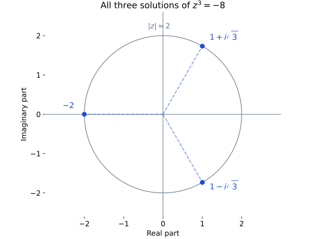

# 003. Trigonometry and complex numbers

**Part:** 3 of 3 — Complex arithmetic, polar form and roots

**Paper:** Mathematics optional, both-paper foundation bridge.
**Learning outcome:** Choose rectangular or polar form, find all roots and distinguish arguments from principal values.

**Curriculum entry:** [Chapter 003](Mains-Mathematics-Curriculum.md#phase-a--orientation-and-selective-bridges).

**Scope:** complex arithmetic, conjugation, modulus, argument, polar form, integer powers, roots, and the elementary complex exponential and logarithm.

**Prerequisites:** [002](002-algebra-inequalities-and-functions.md), [Part 1](003-trigonometry-and-complex-numbers-part-1.md) and [Part 2](003-trigonometry-and-complex-numbers-part-2.md). No complex calculus is assumed.

**Navigation:** [Chapter overview](003-trigonometry-and-complex-numbers.md) · [Part 1](003-trigonometry-and-complex-numbers-part-1.md) · [Part 2](003-trigonometry-and-complex-numbers-part-2.md).

## 1. A new arithmetic system contains the real numbers

No real number squares to $-1$. Introduce a symbol $i$ satisfying $i^2=-1$ and write a complex number as

$$
z=x+iy,\qquad x,y\in\mathbb R.
$$

The set of these numbers is $\mathbb C$. Its real part is $\operatorname{Re}z=x$ and its imaginary part is $\operatorname{Im}z=y$, a **real number**, not $iy$. Equality means equality of both parts: $x+iy=u+iv$ exactly when $x=u$ and $y=v$. Real numbers are the cases $y=0$.

For a concrete construction, regard $x+iy$ as the ordered pair $(x,y)$, with the following operations:

$$
(x+iy)+(u+iv)=(x+u)+i(y+v),
$$
$$
(x+iy)(u+iv)=(xu-yv)+i(xv+yu).
$$

The multiplication rule follows by distributing terms and replacing $i^2$ by $-1$; equivalently it can define multiplication of pairs. These operations extend real arithmetic, and their associative, commutative and distributive laws can be checked by expansion. In particular $(0+i)^2=-1$. The basic terminology agrees with [NIST DLMF §1.9(i)][complex].

**Worked example.**

$$
(2-3i)(1+4i)=2+8i-3i-12i^2=14+5i.
$$

The sign of the last term changes because $i^2=-1$. Repeated multiplication gives $i^0=1$, $i^1=i$, $i^2=-1$, $i^3=-i$, $i^4=1$. Integer powers repeat every four; for example $i^{23}=i^3=-i$.

A quadratic with no real roots can now be solved. Completing the square in $z^2-2z+5=0$ gives $(z-1)^2=-4$, so $z=1\pm2i$. Both substitute correctly. The fact that every nonconstant complex polynomial has roots is a deeper theorem; it is not needed to derive these two solutions or the root formula below.

There is no order on $\mathbb C$ extending real order while satisfying the ordered-field rules. If such an order existed, every square would be nonnegative, including $i^2=-1$, a contradiction. Thus $z>0$ has no ordinary meaning for an arbitrary complex $z$; inequalities involving $|z|$ compare real numbers.

## 2. Conjugation makes division manageable

The **conjugate** of $z=x+iy$ is $\bar z=x-iy$. It reflects the point across the real axis and satisfies

$$
z\bar z=x^2+y^2,\quad
\overline{z+w}=\bar z+\bar w,\quad
\overline{zw}=\bar z\bar w.
$$

The first is a difference of squares; the other two follow by expanding the real and imaginary parts. In particular,

$$
\operatorname{Re}z=\frac{z+\bar z}{2},\qquad
\operatorname{Im}z=\frac{z-\bar z}{2i}.
$$

If $w=u+iv\ne0$, then $u^2+v^2>0$. Multiplying by its conjugate proves

$$
\frac{z}{w}=\frac{z\bar w}{u^2+v^2},\qquad
\frac1w=\frac{u-iv}{u^2+v^2}.
$$

Every nonzero complex number therefore has a multiplicative inverse. As over the reals, division by zero is undefined.

**Worked example.** Express $(2+3i)/(1-2i)$ in rectangular form:

$$
\frac{2+3i}{1-2i}
=\frac{(2+3i)(1+2i)}{(1-2i)(1+2i)}
=\frac{-4+7i}{5}=-\frac45+\frac75i.
$$

Multiplying the answer by $1-2i$ recovers $2+3i$, a check independent of repeating the division.

## 3. The modulus is a distance

Plot $z=x+iy$ at $(x,y)$ on the **complex plane**, with real horizontal coordinate and imaginary vertical coordinate. Define the nonnegative **modulus**

$$
|z|=\sqrt{x^2+y^2}=\sqrt{z\bar z}.
$$

It is the distance from zero. In particular $|z|=0$ exactly when $z=0$, and $|\bar z|=|z|$. The expression $|z-a|$ is the distance between the points $z$ and $a$. For example,

$$
|z-(1+2i)|=3\quad\Longleftrightarrow\quad(x-1)^2+(y-2)^2=9,
$$

a circle centred at $(1,2)$ of radius 3. Addition has its usual displacement interpretation: add horizontal coordinates and vertical coordinates separately.

Conjugation proves the product rule without geometry:

$$
|zw|^2=(zw)\overline{zw}=(z\bar z)(w\bar w)=|z|^2|w|^2.
$$

Both sides' square roots are nonnegative, so $|zw|=|z||w|$. For $w\ne0$, this also gives $|z/w|=|z|/|w|$.

The **triangle inequality** and its reverse form are

$$
|z+w|\le |z|+|w|,\qquad
\bigl||z|-|w|\bigr|\le |z-w|.
$$

For an algebraic proof of the first, note that $\operatorname{Re}q\le|q|$ for any complex $q$, because its horizontal coordinate cannot exceed its distance from zero. Therefore

$$
|z+w|^2=|z|^2+|w|^2+2\operatorname{Re}(z\bar w)
\le |z|^2+|w|^2+2|z||w|.
$$

Take nonnegative square roots. For the reverse inequality, apply the first to $z=(z-w)+w$ to get $|z|-|w|\le|z-w|$, and interchange $z,w$ to get the other sign. This proves the absolute-value form. These inequalities will bound errors and limits later; they are not claims that $|z+w|$ always equals $|z|+|w|$.

## 4. Polar form separates length from direction

For $z\ne0$, set $r=|z|>0$. Since $(x/r)^2+(y/r)^2=1$, some angle $\theta$ satisfies $x/r=\cos\theta$, $y/r=\sin\theta$. Hence

$$
z=r(\cos\theta+i\sin\theta).
$$

This is **polar form**. The radius $r$ is unique; the angle is not. Every angle $\theta+2k\pi$, $k\in\mathbb Z$, represents the same point. Such angles are called **arguments** of $z$. This coordinate conversion is also developed in [OpenStax §8.5][polar].

For a single choice, this chapter uses the **principal argument**

$$
\operatorname{Arg}z\in(-\pi,\pi].
$$

The full set of arguments is $\operatorname{Arg}z+2k\pi$. Other texts may use $[0,2\pi)$; state the convention. Zero has no argument: it has no direction from the origin. It can be represented by radius zero with any angle, which does not define a unique argument.

### 4.1 Find the quadrant before choosing an angle

For $z=-\sqrt3+i$, the modulus is 2 and the point is in quadrant II. Its cosine is $-\sqrt3/2$, its sine is $1/2$, so

$$
\operatorname{Arg}z=5\pi/6,\qquad
z=2\bigl(\cos(5\pi/6)+i\sin(5\pi/6)\bigr).
$$

Blindly using $\arctan(y/x)=\arctan(-1/\sqrt3)=-\pi/6$ selects a quadrant-IV point with the same tangent. Tangent determines direction only up to $\pi$, so check both coordinate signs. On the axes, use their directions directly: $\operatorname{Arg}(-2)=\pi$, $\operatorname{Arg}(-2i)=-\pi/2$.

### 4.2 Products multiply lengths and add angles

Put $\operatorname{cis}\theta=\cos\theta+i\sin\theta$. Multiplication and the addition identities from Part 1 give

$$
\operatorname{cis}\alpha\operatorname{cis}\beta
=\operatorname{cis}(\alpha+\beta).
$$

Thus, for nonzero $z=r\operatorname{cis}\alpha$ and $w=s\operatorname{cis}\beta$,

$$
zw=rs\operatorname{cis}(\alpha+\beta),\qquad
\frac zw=\frac rs\operatorname{cis}(\alpha-\beta).
$$

Multiplying by $i=\operatorname{cis}(\pi/2)$ rotates a point counterclockwise by a quarter-turn without changing its length. Multiplying by a positive real number only changes length.

A sum of principal arguments need not be principal. For $z=w=-1$, $\operatorname{Arg}z+\operatorname{Arg}w=2\pi$, but $zw=1$ has principal argument 0. Add angles for the product, then reduce by a multiple of $2\pi$ to the chosen interval if a principal value is requested.

## 5. Integer powers and all roots

Repeated multiplication proves **de Moivre's formula**:

$$
(r\operatorname{cis}\theta)^n=r^n\operatorname{cis}(n\theta),\qquad n\in\mathbb Z.
$$

For positive integers, the proof starts at $n=1$ and applies the product rule to pass from $n$ to $n+1$. For $n=0$ both sides equal 1 when $r>0$. Negative integers follow by taking reciprocals. Zero may be raised to positive integer powers; the formula's reciprocal step requires a nonzero base. It does not license an unrestricted single-valued rule for fractional complex powers.

**Worked example — a large power.** Since $1+i=\sqrt2\operatorname{cis}(\pi/4)$,

$$
(1+i)^6=(\sqrt2)^6\operatorname{cis}(3\pi/2)=-8i.
$$

The modulus is 8, agreeing with $|1+i|^6$. As an algebra check, $(1+i)^2=2i$, whose cube is $-8i$.

### 5.1 Derive the full root formula

Let $a=R\operatorname{cis}\Theta\ne0$ and let $n$ be a positive integer. To solve $z^n=a$, write $z=r\operatorname{cis}\theta$. The equality requires

$$
r^n=R,\qquad n\theta=\Theta+2k\pi.
$$

The radial equation has exactly one positive solution, $r=R^{1/n}$. The angular equation yields

$$
z_k=R^{1/n}\operatorname{cis}\left(\frac{\Theta+2k\pi}{n}\right),
\qquad k=0,1,\ldots,n-1.
$$

These are exactly $n$ distinct roots: two listed angles differ by $2\pi(k-l)/n$, a full-turn multiple only if $k=l$ within the stated index range. Any other integer $k$ repeats one of these after adding a multiple of $n$. This proves both completeness and distinctness directly for this equation. For $a=0$, the only distinct root is zero.

All nonzero roots lie on the circle of radius $R^{1/n}$ and are equally spaced by $2\pi/n$. For $n\ge3$ they are vertices of a regular polygon; for $n=2$ they are opposite endpoints of a diameter.

**Worked example — all cube roots of $-8$.** Write $-8=8\operatorname{cis}\pi$. The root radius is 2 and the angles are $\pi/3,\pi,5\pi/3$. Thus

$$
z=1+i\sqrt3,\quad -2,\quad 1-i\sqrt3.
$$

Each has modulus 2. Cubing triples each angle to an odd multiple of $\pi$ and cubes the radius to 8, so each cube is $-8$. The familiar real cube root $-2$ is one of three complex roots.

*Original diagram of the computed roots. The angular gaps are all $2\pi/3$.*

For the special equation $z^n=1$, the roots are the **roots of unity**, $\operatorname{cis}(2k\pi/n)$. When $n=4$, they are $1,i,-1,-i$. They multiply by adding angular indices modulo 4, a fact that later motivates cyclic groups in [033](033-cyclic-and-permutation-groups.md); the group-theoretic proof is a later topic.

A root equation and a chosen root function differ. The equation $z^2=-1$ has two solutions, $i$ and $-i$. If a principal square root is defined as $\sqrt r\operatorname{cis}(\operatorname{Arg}z/2)$ for $z\ne0$, its value at $-1$ is $i$ in our convention; it selects one solution. Principal complex roots need not obey familiar product rules: the product of the principal square roots of $-1$ and $-1$ is $i^2=-1$, but the principal square root of their product is $\sqrt1=1$.

## 6. The complex exponential joins scale to rotation

For real $x,y$, define the complex exponential by

$$
e^{x+iy}=e^x(\cos y+i\sin y).
$$

At $y=0$ it agrees with the real exponential. At $x=0$ it gives **Euler's formula**

$$
e^{iy}=\cos y+i\sin y,
$$

so polar form becomes $z=re^{i\theta}$. Taking this as a definition and checking its rules is a standard introductory route; see [Jeremy Orloff's MIT notes, §1.6][mit]. Its equivalence to a power-series definition is deferred until series are available. Substituting $y=\pi$ gives $e^{i\pi}=-1$.

The definition and the angle-addition formulas prove, for all complex $z,w$,

$$
e^{z+w}=e^ze^w,\qquad |e^{x+iy}|=e^x>0.
$$

Thus the exponential never vanishes. It also repeats: $e^{z+2k\pi i}=e^z$. In particular $e^z=1$ requires $e^x=1$, hence $x=0$, and $\cos y=1$, $\sin y=0$, hence $y=2k\pi$. The complex solutions are $z=2k\pi i$, whereas the real equation has only zero.

### 6.1 A logarithm has many values until a choice is imposed

To solve $e^w=z\ne0$, write $w=u+iv$. The modulus condition gives $e^u=|z|$, so $u=\ln|z|$; the direction condition gives $v=\operatorname{Arg}z+2k\pi$. All logarithm values are therefore

$$
\ln|z|+i(\operatorname{Arg}z+2k\pi),\qquad k\in\mathbb Z.
$$

The **principal logarithm value** in our convention is

$$
\operatorname{Log}z=\ln|z|+i\operatorname{Arg}z.
$$

For instance all logarithms of $-1$ are $i(\pi+2k\pi)$, with principal value $i\pi$. These distinctions and the convention on the negative real axis are discussed in [NIST DLMF §4.2][logarithm]. The pointwise principal value here is defined for every nonzero complex number; it jumps across the negative real axis. To obtain the usual analytic principal branch later, remove that axis and zero, using the domain $\mathbb C\setminus(-\infty,0]$. Analyticity and the meaning of a branch are taught in [039](039-complex-differentiability-and-analytic-functions.md).

The real logarithm product law does not hold unconditionally for principal complex values. For $z=w=-1$,

$$
\operatorname{Log}(zw)=\operatorname{Log}1=0,
\qquad \operatorname{Log}z+\operatorname{Log}w=2\pi i.
$$

They differ by a full angular turn. This is exactly the principal-argument issue already seen for products, not a failure of $e^{z+w}=e^ze^w$.

### 6.2 Circular and hyperbolic expressions meet at imaginary inputs

For complex $z$, define

$$
\cos z=\frac{e^{iz}+e^{-iz}}2,\qquad
\sin z=\frac{e^{iz}-e^{-iz}}{2i}.
$$

For real $z$, Euler's formula shows these agree with the circle functions. For real $y$, substitution gives

$$
\cos(iy)=\cosh y,\qquad \sin(iy)=i\sinh y.
$$

For example, $\cos(i\ln2)=(2+1/2)/2=5/4$. The real-input bound $|\cos x|\le1$ does not apply to complex inputs. These identities match [NIST DLMF §4.28][hyperbolic]. Using the exponential definitions also gives

$$
\sin(x+iy)=\sin x\cosh y+i\cos x\sinh y,
$$
$$
\cos(x+iy)=\cos x\cosh y-i\sin x\sinh y.
$$

To reconstruct them, substitute $e^{i(x+iy)}=e^{-y}(\cos x+i\sin x)$ and $e^{-i(x+iy)}=e^y(\cos x-i\sin x)$ into the two definitions, then group real and imaginary coefficients. No complex differentiation is involved.

## 7. Read a later PYQ without pretending its prerequisites are finished

The curriculum anchors this bridge to [2022 Paper II Q1(b)](Mains-Mathematics-PYQS/2022-Mains-Mathematics.md#paper-ii). The typed corpus asks for an analytic function $f=u+iv$ from a specified expression for $u-v$, with $f(\pi/2)=0$. Finding that function requires complex differentiation and harmonic-conjugate methods from chapter 039, so a full solution is deferred.

The expression's denominator is $2\cos x-e^y-e^{-y}$. This chapter already lets you rewrite it as

$$
2(\cos x-\cosh y).
$$

For real $x,y$, this vanishes exactly when $\cos x=1$ and $\cosh y=1$: each side must equal 1 because $\cos x\le1\le\cosh y$. Therefore the displayed ratio excludes $y=0$, $x=2k\pi$. Whether an eventual function admits any extension there requires separate analysis; do not assume a cancelled expression automatically establishes it. At the specified normalisation point $x=\pi/2,y=0$, the denominator is $-2$ and the numerator in the typed stem is zero, consistent with $u-v=0$ at that point.

This is a limited algebra-and-domain reading of the actual stem, not a claimed solution of the analytic reconstruction. The corpus is a typed transcription with its existing source caveat, not a newly verified official scan. No corpus text has been altered.

## 8. Summary of key concepts and takeaways

- Rectangular form makes addition and conjugation transparent; polar form makes multiplication, powers and roots transparent. Choose a representation to suit the operation.
- Modulus is a real distance, while an argument is an angle defined only for nonzero numbers and only up to full turns. A principal argument chooses one representative.
- All $n$th roots require all angular classes. A principal root or logarithm selects values and can lose familiar unrestricted real product laws.
- The complex exponential combines positive scale and rotation; its periodicity explains multiple logarithm values. Elementary identities do not establish analyticity or justify removing singularities.

## 9. UPSC-specific notes

### 9.1 Static notes

| Tool | Revision note for Paper I foundations and Paper II Complex Analysis |
|---|---|
| Arithmetic | $i^2=-1$; equate real and imaginary parts. For $z=x+iy$, $\bar z=x-iy$, $z\bar z=\vertz\vert^2=x^2+y^2$. Divide by nonzero $w$ using $z/w=z\bar w/\vertw\vert^2$. |
| Geometry and bounds | $\vertz-a\vert$ is a distance; $\vertzw\vert=\vertz\vert\vertw\vert$, $\vertz+w\vert\le\vertz\vert+\vertw\vert$, and $\bigl\vert\vertz\vert-\vertw\vert\bigr\vert\le\vertz-w\vert$. An arbitrary complex number has no real order relation; modulus comparisons do. |
| Argument | Here $\operatorname{Arg}z\in(-\pi,\pi]$ for $z\ne0$; all arguments are $\operatorname{Arg}z+2k\pi$. Check both coordinate signs; arctangent of a quotient alone can miss the quadrant. Zero has no argument. |
| Products and powers | For $z=r\operatorname{cis}\theta$, multiply moduli and add angles. Integer de Moivre: $z^n=r^n\operatorname{cis}(n\theta)$; nonpositive powers require $z\ne0$. Reduce angles afterward if a principal result is requested. |
| Roots | For $a=R\operatorname{cis}\Theta\ne0$, roots of $z^n=a$ are $R^{1/n}\operatorname{cis}((\Theta+2k\pi)/n)$, $k=0,\ldots,n-1$. They are distinct, equally spaced; for $a=0$ the only distinct root is zero. |
| Exponential and logarithm | $e^{x+iy}=e^x(\cos y+i\sin y)$ is never zero and has period $2\pi i$. All logarithms of $z\ne0$ are $\ln\vertz\vert+i(\operatorname{Arg}z+2k\pi)$. The pointwise principal value differs from the analytic branch on $\mathbb C\setminus(-\infty,0]$. |
| Convention traps | Principal arguments do not add without reduction. Principal logs and roots do not obey unconditional product rules: at $z=w=-1$, principal log values differ by $2\pi i$ after multiplication. Real sine/cosine bounds do not extend to all complex inputs. |
| Circular/hyperbolic link | $\cos(iy)=\cosh y$ and $\sin(iy)=i\sinh y$ for real $y$. Recover complex-input expressions from exponentials rather than importing real-input bounds. |

The **2022 Paper II Q1(b)** connection only rewrites $2\cos x-e^y-e^{-y}=2(\cos x-\cosh y)$ and identifies excluded points $y=0$, $x=2k\pi$. Analytic reconstruction and possible extension need later methods; the typed PYQ's transcription caveat remains. See the existing [NIST, OpenStax, MIT and corpus sources](#sources).

### 9.2 Current applicability

These are stable mathematical results, not current-affairs facts. Recheck a convention or transcription correction when encountered; do not treat a new PYQ's appearance as a change to the identities. Current paper rules are tracked in [chapter 001](001-orientation-and-diagnostic-route.md#update-watch).

## 10. Revision and next steps

Before moving on, reconstruct complex division using conjugation, explain why the modulus is real and nonnegative, and find an argument using both coordinate signs. Derive the product rule in polar form from the addition identities, and derive all $n$th roots rather than taking only a principal angle divided by $n$. Finally, distinguish a real logarithm, all complex logarithm values, and a principal complex value.

The next bridge is [004 — Coordinates, conics and vector algebra](004-coordinates-conics-and-vector-algebra.md). Complex arithmetic will also support [008 — Matrices and linear systems](008-matrices-and-linear-systems.md) and later spaces over $\mathbb C$. This chapter teaches representations and elementary functions; proofs involving analytic functions, contour integrals and branch domains require the later analysis sequence.

## 11. Update watch

The mathematical definitions, identities and reasoning taught here are stable; no routine factual update is needed. Revisit only if a cited reference is corrected or the course changes its notation, domain or principal-value conventions.

## 12. Sources

All external references accessed **24 November 2026**. Explanations, derivations, numerical examples and diagrams are original.

- NIST, *Digital Library of Mathematical Functions*, [§1.9(i) Complex Numbers][complex]: arithmetic, conjugation, modulus and argument conventions.
- OpenStax, Rice University, *Precalculus 2e*, [§8.5 Polar Form of Complex Numbers][polar]: polar representation, products, powers and roots.
- Jeremy Orloff, Massachusetts Institute of Technology OpenCourseWare, *18.04, Spring 2018, Topic 1: Complex Algebra and the Complex Plane*, [§1.6 Euler's Formula][mit]: the definition-based route to the complex exponential.
- NIST, *Digital Library of Mathematical Functions*, [§4.2 Logarithm, Exponential, Powers][logarithm] and [§4.28 Hyperbolic Functions][hyperbolic]: logarithm conventions and circular/hyperbolic relations.
- Repository working corpus, [2022 Mathematics optional, Paper II Q1(b)](Mains-Mathematics-PYQS/2022-Mains-Mathematics.md#paper-ii), read 24 November 2026; use its recorded transcription caveat and source links.

[complex]: https://dlmf.nist.gov/1.9#i
[polar]: https://openstax.org/books/precalculus-2e/pages/8-5-polar-form-of-complex-numbers
[mit]: https://ocw.mit.edu/courses/18-04-complex-variables-with-applications-spring-2018/6eae09885b0fab3f068e31752198abea_MIT18_04S18_topic1.pdf
[logarithm]: https://dlmf.nist.gov/4.2
[hyperbolic]: https://dlmf.nist.gov/4.28
