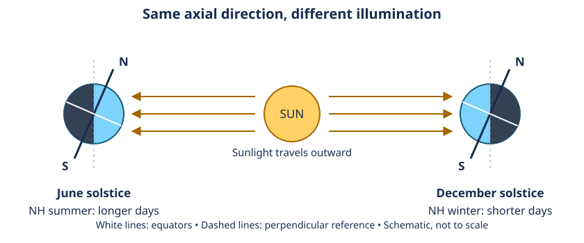

# 007. Earth in the solar system and its motions

**Revision — 23 November 2026:** Corrected the time-zone PYQ discussion, lunar visibility and IST explanation; added seasonal geometry and qualified calendar dates.

- **Paper:** Prelims General Studies I, UPSC CSE 2027.
- **Curriculum entry:** [007 — Earth in the solar system and its motions](Prelims-General-Studies-I-Curriculum.md#chapter-007).
- **Prerequisites:** Chapters 003–006. First chapter in this topic.
- **Scope:** Planets, Earth–Sun–Moon relationships, rotation, revolution, seasons, solstices, eclipses and time differences; detailed astronomy belongs to Chapter 121.
- **Learning outcome:** Explain seasons and day-length differences using a diagram.
- **Define when teaching:** Axis; orbit; solstice; equinox; eclipse.

**Related chapters:** [008 — Earth's interior, rocks and tectonic hazards](008-earth-s-interior-rocks-and-tectonic-hazards.md) · [009 — Weathering, erosion and landforms](009-weathering-erosion-and-landforms.md) · [010 — Atmospheric structure and heat balance](010-atmospheric-structure-and-heat-balance.md) · [011 — Winds, rainfall and weather systems](011-winds-rainfall-and-weather-systems.md) · [015 — India's location and physical regions](015-india-s-location-and-physical-regions.md)

---

## 1. Orientation

This chapter gives you two things. First, a framework for the solar system: what kind of object Earth is, where it sits, and what its Moon does. Second, and more important for the exam, a mechanical explanation of seasons, day-length differences, solstices, equinoxes and eclipses — all traceable to two facts: Earth revolves around the Sun *and* its axis is tilted.

The core PYQ test is: can you separate the effects of rotation, revolution and axial tilt? A common trap is thinking seasons come from changing distance to the Sun (they don't — the Earth is actually *closest* to the Sun in January, the Northern Hemisphere winter). The chapter builds toward the learning outcome: explaining why day lengths change with latitude and season, which is the foundation for Chapters 010 (heat budget) and 011 (wind belts).

---

## 2. The solar system — a brief orientation

The **solar system** consists of the Sun and everything bound to it by gravity: eight planets, their satellites, asteroids, comets and meteoroids ([NCERT Cl. 6, Ch. 1][ncert6-ss]).

### 2.1 The Sun

The Sun is the nearest **star** to Earth — a huge, hot ball of gases that produces its own heat and light through nuclear fusion. Earth orbits the Sun at an average distance of about 150 million km. At the speed of light (~300,000 km/s), sunlight takes about 8 minutes to reach Earth. The Sun's gravitational pull holds the whole system together.

A **star** produces its own light and heat. A **planet** does not; it shines by reflecting starlight and orbits a star. A **satellite** (natural) is a body that orbits a planet.

### 2.2 The eight planets

Pluto was reclassified as a dwarf planet by the International Astronomical Union in 2006 and is no longer counted as a major planet. There are eight planets; the table uses NASA's [planetary facts][nasa-mercury] for Mercury's atmosphere distinction:

| Planet | Type | Key features |
|---|---|---|
| **Mercury** | Inner, rocky | Nearest to the Sun; extremely thin exosphere rather than a substantial atmosphere |
| **Venus** | Inner, rocky | Hottest planet (~467 °C); brightest in the sky; spins opposite to most planets |
| **Earth** | Inner, rocky | Third from Sun; only known planet with life; about 150 million km from Sun |
| **Mars** | Inner, rocky | Called the Red Planet; two moons (Phobos, Deimos) |
| **Jupiter** | Outer, gas giant | Largest planet; about 11× Earth's width |
| **Saturn** | Outer, gas giant | Spectacular ring system; density less than water |
| **Uranus** | Outer, ice giant | Tilted ~98° — rotates nearly on its side; spins opposite to most |
| **Neptune** | Outer, ice giant | Farthest from Sun; winds ~2,000 km/h |

The **asteroid belt** lies between Mars and Jupiter — the boundary between rocky inner planets and large outer ones.

> **Why Earth supports life:** Earth's distance from the Sun keeps it neither too hot nor too cold; its atmosphere contains oxygen and water vapour; liquid water covers about two-thirds of the surface. No other planet in our solar system is known to meet all three conditions together.

### 2.3 The Moon

The Moon is Earth's only natural satellite. Key facts:

- Distance from Earth: ~3,84,400 km.
- The Moon orbits Earth once in about **27.3 days** (sidereal period). Its own rotation also takes the same time — which is why the same side always faces Earth. The far side is mostly hidden, but a small part becomes visible around the edges through **libration**, the apparent rocking of the Moon; over time we can see about 59% of its surface ([NASA][nasa-libration]).
- The Moon has no light of its own; moonlight is reflected sunlight.
- **Phases:** As the Moon orbits Earth, the sunlit fraction we see changes from new moon (invisible) → crescent → quarter → gibbous → full moon and back. One complete cycle takes about **29.5 days** (the synodic month — the basis of the traditional lunar calendar).
- Poornima = full moon; Amavasya = new moon in Indian calendrical tradition.
- The Moon has mountains, craters and plains, and only an extremely thin exosphere rather than a substantial atmosphere. It has water ice in some permanently shadowed polar regions; this is not a system of surface liquid-water lakes ([NASA Moon facts][nasa-moon]).

### 2.4 The light-year

A **light-year** is a unit of *distance* (not time) — the distance light travels in one year, about 9.46 trillion km (9.46 × 10¹² km). It is used for distances between stars and galaxies, not within the solar system (where we use AU — Astronomical Units — or kilometres).

> **[2021 Q65][pyq2021] (Answer: d):** Astronomical distances are measured in light-years because the *speed of light is always the same* (in vacuum) — it is a universal constant. This makes the light-year a fixed, reproducible unit independent of any measuring instrument.

---

## 3. Earth's two key motions

Earth has two independent motions that together explain almost everything in physical geography ([NCERT Cl. 6, Ch. 3][ncert6-mot]; [Bharat Notes][ncert6-mot2]):

| Motion | Description | Period | Main effect |
|---|---|---|---|
| **Rotation** | Spinning on its own axis | ~24 hours | Day and night; apparent movement of the Sun from east to west |
| **Revolution** | Orbiting the Sun | ~365¼ days | The year; combined with axial tilt → seasons and day-length variation |

### 3.1 Rotation

Earth rotates on an imaginary line called the **axis**, running from the North Pole to the South Pole, from **west to east**. This is why the Sun appears to rise in the east and set in the west.

One complete rotation = one **day** (approximately 24 hours).

The **circle of illumination** is the boundary between the sunlit half and the dark half of Earth at any moment. Because the axis is tilted, the circle of illumination does not coincide with the lines of longitude — and that asymmetry is what causes unequal day and night across latitudes.

### 3.2 Revolution

Earth follows an **elliptical** orbit around the Sun, completing one revolution in about **365¼ days**. The quarter-day accumulates: every four years we add one extra day (29 February) — a **leap year** (366 days). The precise Gregorian rule: years divisible by 4 are leap years, *except* century years — those must be divisible by 400 (so 1900 was not a leap year, but 2000 was).

**A common misconception:** because the orbit is elliptical, Earth's distance from the Sun varies. Earth is closest to the Sun (**perihelion**, ~147 million km) around 3 January, and farthest (**aphelion**, ~152 million km) around 4 July. This means Earth is actually nearest the Sun during the Northern Hemisphere's winter. Distance is *not* what causes seasons.

---

## 4. The axial tilt — the engine of seasons

The key to understanding everything that follows is this single fact:

> **Earth's axis is tilted at 23½° from the perpendicular to its orbital plane** (equivalently, the axis makes 66½° with the orbital plane itself). The axis maintains the same tilt and direction (pointing toward Polaris, the North Star) throughout its orbit.

Because the tilt is fixed in space while Earth moves around the Sun:
- For part of the year, the **Northern Hemisphere tilts toward the Sun** — it receives more direct sunlight, for more hours per day. This is Northern Hemisphere summer.
- Six months later, the **Southern Hemisphere tilts toward the Sun** — it has its summer while the Northern Hemisphere has winter.
- The hemispheres have opposite astronomical seasons; local wet and dry seasons also depend on atmospheric circulation.

**Read the geometry.** Both globes keep the north-pointing axis in the same direction. Earth is shown at two opposite points in its orbit; the Sun is between them. Sizes, distances and the drawn tilt are schematic ([NASA seasons][nasa-seasons]).

*Original schematic based on NASA's explanation. Sizes and distances are not to scale; the axes are drawn at 23.5° from the vertical reference. The axial direction stays nearly fixed over one year, while the direction to the Sun changes.*

**Why tilt controls heat received:**
1. *Angle of rays:* When the Sun is high in the sky, its rays strike a small area — concentrating heat. When it is low (near the horizon), the same energy spreads over a larger area and is weaker. The same energy warms less.
2. *Hours of daylight:* A hemisphere tilted toward the Sun has longer days, so it receives sunlight for more hours.

> **[2013 Q19][pyq2013] (Answer: b):** Variations in the length of daytime and nighttime from season to season are due to *the revolution of the Earth on a tilted axis*. Rotation alone (option a) gives day/night but not seasonal variation. The elliptical orbit (option d) changes distance, not the tilt of the axis. Option b combines both revolution AND tilt, which is the correct mechanism.

---

## 5. Solstices and equinoxes

As Earth orbits the Sun over a year, the Sun's overhead position migrates between 23½°N (Tropic of Cancer) and 23½°S (Tropic of Capricorn). Four key positions define the year:

The dates below are conventional textbook approximations. Actual event dates can shift by a day with the year and time zone; the geometry is the point to learn.

### 5.1 Summer solstice (Northern Hemisphere) — around 21 June

- Sun's overhead position: **Tropic of Cancer (23½°N)**.
- Northern Hemisphere: longest day, shortest night.
- North Pole has continuous daylight (24-hour day).
- South Pole has continuous darkness (24-hour night).
- Southern Hemisphere: winter — shorter days, longer nights.

### 5.2 Winter solstice (Northern Hemisphere) — around 21–22 December

- Sun's overhead position: **Tropic of Capricorn (23½°S)**.
- Northern Hemisphere: shortest day, longest night.
- South Pole has continuous daylight.
- North Pole has continuous darkness.
- Southern Hemisphere: summer — their longest day.

### 5.3 Equinoxes — around 20–21 March and 22–23 September

- Sun's overhead position: the **Equator (0°)**.
- Day and night are approximately equal (12 hours each) everywhere on Earth.
- 21 March: **vernal (spring) equinox** in the Northern Hemisphere.
- 23 September: **autumnal (autumn) equinox** in the Northern Hemisphere.
- The Southern Hemisphere experiences these in reverse.

> **[2024 Q17][pyq2024] (Answer: d — 2 and 4):** On 21 June, latitudes that experience more than 12 hours of sunlight are the Tropic of Cancer (23½°N) and the Arctic Circle (66½°N). In the idealised geometry, the Equator gets 12 hours; actual sunrise-to-sunset duration is slightly longer because of refraction and the Sun's apparent size. The Tropic of Capricorn is in the Southern Hemisphere, which is in its winter on 21 June — it gets fewer than 12 hours.

A summary table:

| Event | Date | Sun overhead | NH day length | SH day length |
|---|---|---|---|---|
| Summer solstice (NH) | 21 June | Tropic of Cancer 23½°N | Longest | Shortest |
| Autumnal equinox | 23 September | Equator 0° | 12 hours | 12 hours |
| Winter solstice (NH) | 22 December | Tropic of Capricorn 23½°S | Shortest | Longest |
| Vernal equinox | 21 March | Equator 0° | 12 hours | 12 hours |

---

## 6. The significance of key latitudes

The axial tilt of 23½° defines four circles of latitude that mark the limits of special sunlight behaviour:

| Latitude | Name | Significance |
|---|---|---|
| **23½°N** | Tropic of Cancer | Northernmost latitude where the Sun is ever directly overhead (at the June solstice) |
| **23½°S** | Tropic of Capricorn | Southernmost latitude where the Sun is ever directly overhead (at the December solstice) |
| **66½°N** | Arctic Circle | Southernmost latitude in the Northern Hemisphere where the Sun never sets on the June solstice and never rises on the December solstice |
| **66½°S** | Antarctic Circle | Equivalent in the Southern Hemisphere |

**Midnight sun:** North of the Arctic Circle, around the June solstice, the Sun never dips below the horizon for a period ranging from one day (at 66½°N exactly) to six months (at the North Pole). The same phenomenon occurs south of the Antarctic Circle around the December solstice.

**Polar night:** The same locations experience continuous darkness for an equivalent period in the opposite season.

Notice: 23½° + 66½° = 90°. The Tropic and the polar circle are geometrically complementary — a consequence of the same 23½° axial tilt.

---

## 7. Day-length variation with latitude

Understanding day-length differences is the chapter's core learning outcome. The key relationships:

- **At the Equator:** Day length is always close to 12 hours throughout the year (small variation because the Equator is equidistant from both poles regardless of tilt).
- **Between the Equator and the Tropics:** Some variation — longer days in summer, shorter in winter; the further from the Equator, the larger the swing.
- **At the Tropics (23½°):** Noticeable variation — roughly 13.5 hours at the summer solstice, 10.5 hours at the winter solstice.
- **At the Arctic/Antarctic circles (66½°):** Extreme variation — 24 hours at the summer solstice (midnight sun), 0 hours at the winter solstice (polar night).
- **Beyond the polar circles, toward the poles:** Even longer stretches of continuous day/night, up to 6 months at the poles.

> **[2025 Q13][pyq2025] (Answer: b — only Statement III explains Statement I):** Statement I: a shift in Earth's rotation and axis is occurring. Statement III: as polar ice melts, water moves toward the equator — TRUE and it explains Statement I. When mass redistributes from the poles to lower latitudes, the moment of inertia of Earth increases slightly, which slows rotation very marginally (conservation of angular momentum — same effect as a spinning skater extending their arms). This also shifts the axis. Statement II: solar flares bombarding Earth's outermost atmosphere — TRUE as a fact, but solar flares affect the upper atmosphere magnetically; they do not alter Earth's rotation or axis. Both II and III are correct facts, but only III explains Statement I.

---

## 8. Eclipses

An **eclipse** occurs when one celestial body passes into the shadow of another ([Drishti IAS][drishti-ecl]). The Sun is so large compared to both Earth and Moon that two distinct shadow regions form:

- **Umbra:** the cone of complete shadow, where all direct sunlight is blocked.
- **Penumbra:** the outer cone of partial shadow, where some direct sunlight is blocked.

### 8.1 Solar eclipse — the Moon blocks the Sun

A solar eclipse occurs when the **New Moon** passes between the Sun and Earth, casting its shadow on part of Earth's surface. Because the Moon is small, only part of Earth sees the eclipse.

| Type | Condition | What you see |
|---|---|---|
| **Total** | Moon is close enough that its umbra reaches Earth's surface; perfect alignment | Sun's disk fully covered; only the corona (outer atmosphere) visible; sky darkens |
| **Annular** | Moon is near its farthest point from Earth (appears smaller than the Sun); Moon in line but doesn't fully cover the Sun | A bright ring ("annulus") of sunlight visible around the Moon's silhouette |
| **Partial** | Slight misalignment; only the Moon's penumbra covers the observer | A crescent-shaped portion of the Sun is visible |

### 8.2 Lunar eclipse — Earth blocks the Sun from the Moon

A lunar eclipse occurs when the **Full Moon** passes into Earth's shadow. Because Earth is large, the whole Moon can pass through Earth's umbra.

| Type | Condition | What you see |
|---|---|---|
| **Total** | Entire Moon passes through Earth's umbra | Moon turns deep red or orange ("Blood Moon") — sunlight refracted through Earth's atmosphere reaches the Moon |
| **Partial** | Moon partially enters Earth's umbra | Part of the Moon turns dark |
| **Penumbral** | Moon passes only through Earth's penumbra | Very subtle darkening; hard to notice |

### 8.3 Why eclipses don't happen every month

If the Moon orbited exactly in Earth's orbital plane (the ecliptic), there would be a solar eclipse at every new moon and a lunar eclipse at every full moon. But the Moon's orbit is tilted about **5°** relative to Earth's orbit. Most months the Moon passes slightly above or below the Sun/Earth shadow path. Eclipses only occur when the Full Moon or New Moon coincides with the Moon being near the two **nodes** (the points where the Moon's orbit crosses Earth's orbital plane).

---

## 9. Time zones and India Standard Time

### 9.1 Why time zones exist

Earth rotates 360° in 24 hours — that is 15° of longitude per hour (360 ÷ 24 = 15). If every place used the Sun's position directly to set its clock (local solar time), clocks would be different for every longitude. Even 1° of longitude = 4 minutes of time difference.

To make time manageable, the world is divided into **time zones**, each ideally spanning 15° of longitude and differing from its neighbour by 1 hour. The reference is **Greenwich Mean Time (GMT)** / **UTC (Coordinated Universal Time)** at 0° longitude (the Prime Meridian, which passes through Greenwich, England).

In practice, time zones follow political and administrative boundaries, so countries can have partial-hour differences and some large countries have multiple zones.

> **[2025 Q96][pyq2025b] — correction to the earlier explanation:** The listed countries are **United Kingdom, Denmark, New Zealand, Australia and Brazil**. The working corpus records **(b), only four**. The earlier explanation incorrectly substituted France, the USA and Russia and should not be learned. The scope of “country” matters: overseas territories and associated jurisdictions can add time zones; GMT and British Summer Time are seasonal clock settings, not two simultaneous geographic zones in mainland Britain. Brazil has **four**, not more than four, standard UTC offsets ([INPE][inpe-time]). Check the other countries with the territorial scope and date stated; do not count IANA zone identifiers as distinct UTC offsets, since identifiers also distinguish historical clock rules ([IANA][iana-zones]). The working key is retained with the corpus's verification caveat; it has not been independently certified against the official booklet and key in this revision.

### 9.2 India Standard Time (IST)

India uses a **single time zone** nationwide despite spanning roughly 30° of longitude (68°E to 97°E), which could justify about 2 hours of local time variation. A single zone simplifies national coordination.

- **Standard meridian of India: 82°30′E** (82.5°E).
- This meridian runs through **Mirzapur, Uttar Pradesh** (near Allahabad/Prayagraj), chosen approximately at the geographical centre of India's east–west span.
- **IST = UTC + 5 hours 30 minutes** (5.5 × 15° = 82.5°).

The 30-minute component follows because 82.5° is halfway between the 75°E and 90°E meridians, which correspond to UTC+5 and UTC+6: 82.5° ÷ 15° per hour = 5.5 hours. A half-degree alone corresponds to only two minutes.

---

## 10. Connecting the whole picture

The table below traces every important phenomenon in this chapter back to the same underlying mechanics:

| Phenomenon | Cause | Varies with |
|---|---|---|
| Day and night | Rotation | — (always ~12 hrs at equator; varies at higher latitudes) |
| Apparent east-to-west movement of the Sun | Rotation (Earth spins west-to-east; Sun appears to move the other way) | — |
| The year | Revolution | — |
| Leap year | Revolution (365¼ days, not 365 exactly) | — |
| Seasons | Revolution + axial tilt | Hemisphere (NH/SH have opposite seasons) and time of year |
| Day-length variation across the year | Axial tilt | Latitude (greater variation at higher latitudes) |
| Midnight sun / polar night | Axial tilt | High latitudes only (beyond 66½°) |
| Solstices (June 21, Dec 22) | Maximum axial tilt toward/away from Sun | — |
| Equinoxes (Mar 21, Sep 23) | No net tilt toward either pole | — |
| Solar eclipse | Moon between Sun and Earth (New Moon) | Type depends on Moon's distance from Earth |
| Lunar eclipse | Earth between Sun and Moon (Full Moon) | Type depends on alignment |
| Not monthly eclipses | Moon's orbit tilted ~5° to ecliptic | — |
| Time zones | Rotation (15°/hr) | Longitude |

---

## 11. Common confusions

| Confusion | Clarification |
|---|---|
| **Seasons caused by distance from Sun** | Wrong. Earth is closest to the Sun (perihelion) in January — Northern Hemisphere winter. Seasons come from axial tilt changing the angle of sunlight and the length of daylight. |
| **Equinox = exactly 12 hours day everywhere** | Almost. At the equinoxes, day and night are very close to equal, but refraction of sunlight through the atmosphere means the Sun is visible slightly before it geometrically rises and after it geometrically sets, making days a few minutes longer than 12 hours at most locations. |
| **Revolution vs rotation** | Revolution = moving around the Sun (one year). Rotation = spinning on own axis (one day). The common exam trap is attributing seasonal variation to rotation alone. |
| **Solstice = furthest from Sun** | No. Solstice means "sun stands still" — the moment when the Sun's overhead position stops moving toward a pole and starts moving back. The June solstice is when Earth is near aphelion (farthest from Sun), not closest. |
| **Moon's orbital period = lunar month** | There are two periods: the sidereal period (27.3 days — one orbit relative to stars) and the synodic period (29.5 days — new moon to new moon, the basis of the lunar calendar). The difference arises because Earth has also moved around the Sun during those 27 days, so the Moon needs about 2 extra days to return to the same position relative to the Sun. |
| **Solar eclipse at every new moon** | No — the Moon's orbit is tilted ~5° to Earth's orbital plane, so the Moon usually passes above or below the Sun–Earth line and no eclipse occurs. |
| **IST is 5½ hours ahead of GMT** | Correct. IST = UTC + 5:30. The standard meridian is 82°30′E = 82.5°, and 82.5 ÷ 15 = 5.5 hours. |

---

## Sources

- **IANA.** [Time Zone Database: zone1970.tab and its explanatory comments][iana-zones]. Accessed 23 November 2026.

- **INPE, Government of Brazil.** [Astronomia no dia a dia, lesson 1, slide 69: four Brazilian time zones][inpe-time]. Accessed 23 November 2026.

- **NASA Space Place.** [What Causes the Seasons?][nasa-seasons]. Accessed 23 November 2026.

- **NASA.** [Mercury Facts][nasa-mercury]. Accessed 23 November 2026.

- **NASA.** [Moon Facts][nasa-moon]. Accessed 23 November 2026.

- **NASA Scientific Visualization Studio.** [Moon Wobble][nasa-libration]. Accessed 23 November 2026.

- **NCERT Class 6, Geography (The Earth Our Habitat), Ch 1 — The Earth in the Solar System.** Via Bharat Notes, accessed November 2026.
- **NCERT Class 6, Geography (The Earth Our Habitat), Ch 3 — Motions of the Earth.** Via BPSC Pathshala and Bharat Notes, accessed November 2026.
- **Drishti IAS — Types of eclipses.** Accessed November 2026.

[ncert6-ss]: https://bharatnotes.com/ncert/class-6/earth-our-habitat/the-earth-in-the-solar-system/
[ncert6-mot]: https://bpscpathshala.com/?p=6442
[ncert6-mot2]: https://bharatnotes.com/ncert/class-6/earth-our-habitat/motions-of-the-earth/
[drishti-ecl]: https://www.drishtiias.com/daily-updates/daily-news-analysis/types-of-eclipses
[pyq2013]: Prelims-General-Studies-I-PYQS/2013-Prelims-General-Studies-I.md
[pyq2021]: Prelims-General-Studies-I-PYQS/2021-Prelims-General-Studies-I.md
[pyq2024]: Prelims-General-Studies-I-PYQS/2024-Prelims-General-Studies-I.md
[pyq2025]: Prelims-General-Studies-I-PYQS/2025-Prelims-General-Studies-I.md
[pyq2025b]: Prelims-General-Studies-I-PYQS/2025-Prelims-General-Studies-I.md
[nasa-libration]: https://svs.gsfc.nasa.gov/10836/

[nasa-moon]: https://science.nasa.gov/moon/facts/
[nasa-mercury]: https://science.nasa.gov/mercury/facts/

[nasa-seasons]: https://spaceplace.nasa.gov/seasons/en/
[inpe-time]: https://www.gov.br/inpe/pt-br/eventos/ciaa/2022/repositorio-de-arquivos/pdfs/astronomia-no-dia-a-dia/minicurso_astronomianodiadia_1_andre_ciaa2021online.pdf

[iana-zones]: https://data.iana.org/time-zones/tzdb/zone1970.tab
