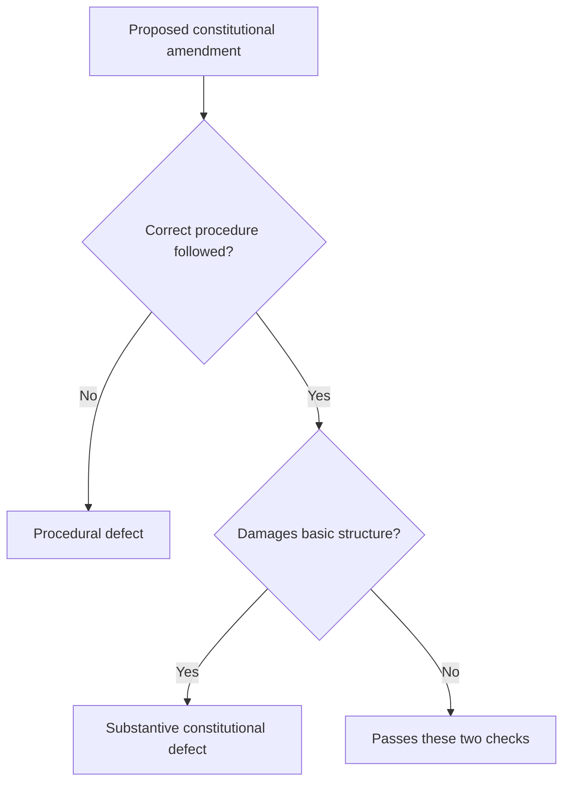

# 023. Constitutional structure, citizenship and change
## Part 3 of 3 — Amendment and constitutional limits

**Paper:** Prelims General Studies I. **Authored:** 24 November 2026.

**Chapter and curriculum:** [Chapter overview](023-constitutional-structure-citizenship-and-change.md) · [curriculum entry](Prelims-General-Studies-I-Curriculum.md#chapter-023).

**Prerequisites:** Chapter 022 and Parts [1](023-constitutional-structure-citizenship-and-change-part-1.md) and [2](023-constitutional-structure-citizenship-and-change-part-2.md). This part teaches all arithmetic needed for its majority examples. The voting scenarios are invented illustrations, not accounts of actual divisions.

## 1. First identify what is being changed

A constitution must be stable enough to constrain the government yet adaptable enough to address new circumstances. An **amendment** is a formal addition, alteration or repeal of constitutional text through the authorised route. A new government policy is not automatically an amendment, and a court's interpretation is not the same procedure as Parliament formally changing the text.

Distinguish three situations:

| Proposed change | Kind of action | Starting point |
|---|---|---|
| Alter an eligibility condition in the Citizenship Act | Amend an ordinary statute | Article 11 and the statutory framework |
| Reorganise States with necessary First/Fourth Schedule adjustments | Use an express constitutional ordinary-law route | Articles 3 and 4 |
| Alter a constitutional provision through the general amending power | Exercise constituent power | Article 368, including its ratification proviso where applicable |

Sources: [Articles 3–4, 11 and 368][constitution]. The important question is **which provision authorises the change**, not whether its political consequences are large or small.

An ordinary law cannot simply contradict an operative constitutional restriction. For instance, if an enactment attempts to override a constitutional requirement without using a valid power to change it, calling the enactment a “reform” does not solve the conflict. Conversely, Article 4 expressly permits specified schedule adjustments without treating the law as an Article 368 amendment.

## 2. Different routes require different procedures

### Ordinary-law routes expressly provided by the Constitution

Article 4 is one example. Article 169 is another: Parliament can create or abolish a State Legislative Council by law after the State Legislative Assembly passes the prescribed initiating resolution. Article 169(3) says the resulting law is not an Article 368 amendment. **The State Assembly's initiating resolution itself requires a special majority**, even though Parliament's law follows ordinary voting rules. “Outside Article 368” does not mean “no special condition anywhere”. [Articles 4 and 169][constitution]

A **simple majority** means more votes in favour than against among members present and voting. Abstentions are not votes in the denominator. Subject to special constitutional rules, Article 100 supplies the ordinary parliamentary voting rule. Quorum and the presiding officer's voting arrangements are separate matters covered in Chapter 029. [Article 100][constitution]

### Article 368: the general amendment route

The bill may be introduced in **either House of Parliament**. A State legislature cannot initiate an Article 368 bill in Parliament, and there is no general requirement of prior presidential recommendation for introducing such a bill. That differs from the Article 3 route taught in Part 1. [Article 368(2)][constitution]

Each House must pass the bill separately by **both** of these thresholds:

1. A majority of the **total membership** of that House.
2. A majority of **not less than two-thirds of members present and voting**.

Do not replace “and” with “or”. There is **no joint sitting** to resolve disagreement over an Article 368 amendment. Its requirement that each House separately pass the bill cannot be replaced by pooling their votes through the ordinary joint-sitting mechanism. [Article 368][constitution]

After any required State ratification, the bill is presented to the President, who **shall give assent** under Article 368(2). This is not the discretionary return-or-withhold framework that a learner might infer from ordinary bills. An individual amendment's commencement provisions must still be checked; do not assume every amended provision becomes operative on an identical date merely because the Act received assent. [Article 368 and amendment commencement notes][constitution]

### When States must ratify

An additional requirement applies to changes within Article 368(2)'s specified federal categories. At least **one-half of the States' legislatures** must ratify by resolutions **before** the bill is presented to the President for assent. It is not necessary to secure ratification from every State. [Article 368(2) proviso][constitution]

The proviso identifies:

| Listed provision or subject | What it concerns |
|---|---|
| Articles **54 and 55** | Election of the President |
| Articles **73 and 162** | Extent of Union and State executive power |
| Article **241** | High Courts for Union territories |
| Article **279A** | GST Council |
| Chapter IV of Part V and Chapter V of Part VI | Union judiciary and State High Courts |
| Chapter I of Part XI | Distribution of legislative powers |
| Any List in the **Seventh Schedule** | Union, State and Concurrent legislative subjects |
| Representation of States in Parliament | Their parliamentary representation |
| Article **368** itself | The amendment framework |

This table follows the actual proviso, rather than using the loose shortcut “anything that affects a State”. A territorial law under Articles 3–4 is not converted into an Article 368 ratification case merely because it affects a State. Equally, a proposal cannot escape ratification by choosing a misleading title: examine the constitutional provisions and effects involved.

State ratification is a different act from Parliament's passage. Article 368 does not impose Parliament's two-threshold majority on State ratification resolutions; ordinary State voting rules apply unless another applicable provision requires otherwise. Also distinguish **at least half the States** from half the population, half the Union territories, or half the members of all State legislatures combined. [Articles 189 and 368][constitution]

## 3. Work out the majority rather than guessing it

Let **T** be total House membership and **V** the number present and voting. For the Article 368 parliamentary thresholds:

- The first minimum is one more than half of T, rounding down before adding one.
- The second minimum is two-thirds of V, rounded **up** where necessary.
- The required affirmative votes must meet the **larger** of these two minimums.

A compact expression is:

**Required yes votes = max(floor(T ÷ 2) + 1, ceil(2V ÷ 3)).**

Here, *floor* means round down to an integer, and *ceil* means round up. These operations are needed because a person cannot cast a fraction of a vote.

### Example A: two-thirds alone is insufficient

Assume a hypothetical House has total membership **500**. Of 400 attending members, 40 abstain, so **360 are present and voting**.

- More than half of total membership: 500 ÷ 2 = 250, so at least **251** must vote yes.
- Two-thirds of present and voting: 2 × 360 ÷ 3 = **240**.
- Both conditions apply, so the minimum is **251**, not 240.

If the division is 245 in favour and 115 against, more than two-thirds of voters support the bill, but the total-membership threshold is not met. The bill does not pass under Article 368 in that House.

### Example B: the voting threshold can be the larger one

Keep total membership at 500, but let **450 vote**. Two-thirds is **300**. The minimum is now 300, because the separate 251 requirement is already included within it. A tally of 290 in favour satisfies the total-membership test but fails the two-thirds test.

### Example C: fractions and State counts

If 301 members vote, two-thirds is 200⅔, so **201**, not 200, affirmative votes are needed for that limb. For State ratification, if there were a hypothetical 29 States, “not less than one-half” would require **15** ratifying State legislatures. These examples are arithmetic exercises, not statements of the current strength of Parliament or current State count.

The denominator must match the rule. Attendance, present-and-voting membership and total membership are three distinct quantities.

## 4. Procedure does not make the amending power unlimited

The **basic-structure doctrine** holds that Parliament's amending power cannot destroy or damage the Constitution's basic structure. It emerged from **Kesavananda Bharati v. State of Kerala, decided on 24 April 1973**. Parliament can amend constitutional provisions, including Fundamental Rights, but it cannot use amendment to eliminate the Constitution's foundational identity. [Supreme Court's case resource][kesavananda]; [I. R. Coelho, discussion and conclusions][coelho]

This is a **judicial doctrine**, not an exhaustive definition written into Article 368. Courts identify and apply the relevant basic features in cases. Constitutional supremacy, the rule of law, judicial independence and separation of powers are examples in the Supreme Court's explanatory account; this is not a closed checklist or a claim that every rule within those subjects can never change. [Supreme Court's conclusion page][kesavananda]

**Worked distinction:** Changing an administrative arrangement concerning courts and abolishing all independent judicial scrutiny are different proposals. Identifying the word “judiciary” in a proposal does not settle the case; its constitutional effect matters. Likewise, passing an amendment unanimously would answer the voting question, but would not by itself answer a basic-structure objection.

Use two separate checks:

The diagram separates the two checks; it does not imply that one label decides every disputed case without judicial interpretation.

### Read judicial-status footnotes

The official text reproduces Article 368 clauses (4) and (5), inserted by the Forty-second Amendment, alongside a footnote stating that the relevant section was declared invalid in **Minerva Mills Ltd. v. Union of India (1980)**. Their wording purports to exclude court challenges and remove all limits on constituent power. Quoting that wording while ignoring the invalidity note gives the opposite of the operative legal position. [Article 368 footnote concerning Section 55 of the Forty-second Amendment][constitution]

This is why the document-reading method in Part 1 matters: **printed historical wording is not necessarily operative law**. Square brackets and footnotes require attention, not automatic deletion or automatic acceptance.

### The Ninth Schedule is not complete immunity

Article 31B and the Ninth Schedule were designed to protect listed enactments against specified Fundamental Rights objections. But **I. R. Coelho v. State of Tamil Nadu (2007)** rejects the proposition that inclusion places a law beyond all constitutional review. [Judgment, concluding propositions (i)–(vi)][coelho]

The Court's conclusions address constitutional amendments **on or after 24 April 1973** adding laws to the Ninth Schedule. Their impact can be tested against basic structure, including the relevant rights principles reflected in Articles 14, 19 and 21. The analysis concerns the actual effect of the protection and the law on basic features; it does not equate every restriction of a Fundamental Right with destruction of basic structure. The judgment also preserves specific qualifications concerning already upheld laws and finalised actions. [I. R. Coelho, conclusions, pp. 40–41][coelho]

For the learner, retain the bounded rule: Parliament can place an enactment in the Ninth Schedule through constitutional amendment, but “therefore no court can examine it” is an unjustified inference. Detailed litigation doctrine belongs to [Chapter 032](032-courts-jurisdiction-and-judicial-review.md), currently planned.

## 5. Apply the distinctions to the local PYQs

These explanations concern the existing local questions; they are not an additional assessment. Keep their source and transcription caveats. In particular, the 2020 file lists 102 items although the official paper had 100, so its numbers are local reference points rather than verified official-set numbers.

| Local item | Reasoning and outcome |
|---|---|
| [2013 Q39](Prelims-General-Studies-I-PYQS/2013-Prelims-General-Studies-I.md) | Statement 1 restricts initiation to the Lok Sabha: false, because either House may initiate. Statement 2 demands ratification by all States: false, because the specified minimum is half. Neither statement is correct, option **(d)**. |
| [2022 Q63](Prelims-General-Studies-I-PYQS/2022-Prelims-General-Studies-I.md) | For the Article 368 bill described, prior presidential recommendation is not required, but presidential assent is obligatory once properly presented, and each House must separately pass it by the prescribed special majority without a joint sitting. Statements 2 and 3 are correct, option **(b)**. Do not import the Article 3 recommendation requirement. |
| [2018 Q54](Prelims-General-Studies-I-PYQS/2018-Prelims-General-Studies-I.md) | Parliament may place a law in the Ninth Schedule, but that does not eliminate judicial scrutiny in all circumstances. Statement 1 is correct and statement 2 false: option **(a)**. Both-correct and neither-correct combinations ignore one side of this distinction. |

### Explicit discrepancy: local 2020 Q28

**Encountered and checked on 24 November 2026.** The [local file](Prelims-General-Studies-I-PYQS/2020-Prelims-General-Studies-I.md) records answer **(d), neither statement**, for a two-statement question about basic structure and judicial review. For the stem as transcribed, that key conflicts with the constitutional sources:

1. “The Constitution defines its basic structure” through the listed concepts: **false**. The doctrine and its application come from constitutional adjudication, not an exhaustive textual definition.
2. The Constitution provides judicial review to safeguard liberties and constitutional ideals: **true**. Articles **13, 32 and 226** provide identifiable constitutional foundations; the basic-structure account also recognises judicial review's significance.

Therefore **(b), statement 2 only**, is the independently reasoned answer for the reproduced stem. Option (a) reverses the truth values; (c) incorrectly accepts the first statement; (d) incorrectly rejects the second. [Constitution, Articles 13, 32 and 226][constitution]; [Supreme Court's basic-structure resource][kesavananda]

This is a disclosed correction to the teaching interpretation, **not a claim that the official UPSC answer key or original booklet has been verified here**. The original corpus entry has been left intact. Do not memorise its recorded answer as constitutional doctrine.

## 6. Finish with a method you can reuse

For any proposed change, identify the legal provision being changed and the provision authorising the change. Ask whether the Constitution supplies an ordinary-law exception. If Article 368 applies, calculate both parliamentary thresholds, check whether the State-ratification proviso applies, and distinguish proper passage from substantive constitutional validity.

For a document question, read the operative article together with its provisos, explanations, schedules and legal-status footnotes. For a citizenship or language claim, identify the date, beneficiary and institution rather than inferring the answer from a familiar label. These are the practical skills this chapter adds to Chapter 022's political foundations.

**Next:** [024 — Fundamental Rights and constitutional remedies](024-fundamental-rights-and-constitutional-remedies.md), currently a planning placeholder. Return to the [Chapter 023 overview](023-constitutional-structure-citizenship-and-change.md) for all three parts.

## Sources and maintenance

External sources accessed **24 November 2026**:

- **Legislative Department, Government of India, _The Constitution of India_, as on 10 September 2026.** [Official PDF][constitution]. Articles 3–4, 11, 13, 32, 100, 169, 189, 226 and 368; Article 368's judicial-invalidity footnote. Primary text for procedural and majority rules.
- **Supreme Court of India, _The Basic Structure Judgment: Kesavananda Bharati_, conclusion and linked case material.** [Official case resource][kesavananda]. Limits on constituent power and illustrative foundational principles. This explanatory resource is read alongside the judicial treatment in Coelho, rather than treated as a statutory definition.
- **Supreme Court of India, _I. R. Coelho (Dead) by LRs v. State of Tamil Nadu_, judgment of 11 January 2007, (2007) 2 SCC 1.** [Official judgment PDF][coelho], particularly concluding propositions (i)–(vi), pp. 40–41. Primary judicial source for the Ninth Schedule qualification and review after the Kesavananda date.

Recheck after relevant amendments, changes to the ratification categories or controlling judgments. Numerical voting examples are deliberately hypothetical. No new formal test, checkpoint, score or learner feedback has been created.

[constitution]: https://www.legislative.gov.in/static/uploads/2025/08/b9a933fb88c0a5afba254256bc55a3f0.pdf
[kesavananda]: https://judgments.ecourts.gov.in/KBJ/?p=home/conclusion
[coelho]: https://api.sci.gov.in/jonew/judis/30879.pdf
